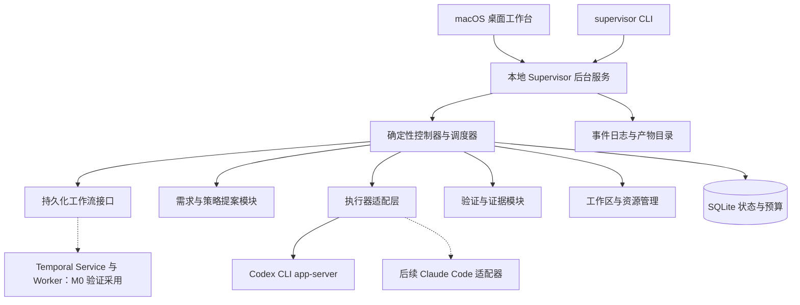

# Supervisor 产品方案与技术架构

Supervisor（项目目录 Agents_Supervisor）定位为运行在 macOS 上的长程任务监督管理器：把用户目标转成可验证的任务契约，调度 Codex 执行，持续检查产物是否可用，并在失败、中断或需求变化后继续推进。产品价值集中在需求质量、执行控制、验收证据与恢复能力。

已确认：产品采用独立 macOS App，先供个人长期自用验证，放弃作为 Codex 插件的产品路线；首接 Codex CLI，保留 Claude Code 适配接口。桌面工作台与独立本地监督服务共同组成产品，CLI 是同一服务的控制入口。本文是设计基线；P0 工程与测试基座、P1 领域内核与真实持久化已完成；P2 真实 Codex 单次执行与 Electron/React 桌面薄切片已通过阶段门禁及独立复核。自主 Loop、产品独立验证器和完整恢复编排仍按后续阶段实现。实际进度以 [README](../README.md) 为准。基础技术资料核对日期为 2026 年 10 月 9 日；监控、模型路由、UI 验收、记忆与 Temporal 决策更新于 2026 年 10 月 10 日。

已确认的任务范围：代码开发、修复与项目交付是核心需求；研究、资料整理和 deep research 同样需要支持，并作为检验通用长程监督能力的重要场景。首版同时提供工程交付与研究整理的任务模板和验收方式，共用同一监督内核。

已确认的工作方式：前期与用户对齐需求定义、目标平台、UI 风格和交付标准；对齐后，在既定范围、风格、授权和预算内自主决策、执行和修正。实现细节不逐项请示，影响目标、业务语义或交付承诺的变化需要重新对齐。

产品保持内部模块化，便于替换执行器、验证器和调度策略；这不要求将产品制作成宿主插件，也不要求首版建设插件市场。

实施依赖与阶段验收详见 [开发计划](development-plan.md)。Supervisor 自身按底层规则、持久化、真实执行、恢复、独立验证、监督 Loop、多 Agent 及产品交付逐层构建，每阶段同时要求适用的完整单元测试和真实系统运行证据。本文中的 mock 协作场景描述受监督项目的开发手段，不作为 Supervisor 阶段通过依据。

## 产品目标和设计原则

用户应随时知道：目标是什么、哪些 Agent 正在做什么、为什么继续或停止、产物还差什么、自己是否需要介入。

- 任务完成依据事先约定的验收条款和当前产物证据。

- 测试与验收用例是项目级持续维护的资产。Supervisor 随开发、研究和需求变化补齐、修改、合并或退役用例，按影响选择执行；每轮冻结验收集合，不能以删测或改预期制造完成。

- 多开 Agent 的前提是能缩短交付时间；资源允许时主动并行，不把单 Agent 作为固定起点。

- 用户需求理解、计划调整、执行、独立验证都有明确职责；主控程序保存最终状态。

- 能力和权限足以支撑真实项目操作，同时明确记录每次任务的工作路径、授权与副作用。

- 界面关闭、CLI 崩溃、网络中断与需求变更都属于正常产品流程。

- 用户的隐含需求以待确认假设呈现，不能静默扩大任务范围。

## 需求理解和执行准入

需求模块输出版本化 TaskContract，至少包含：期望结果、使用者与场景、输入与项目路径、范围及排除项、约束、验收条款、允许操作、预算和未决问题。每条需求标注来源为用户明确要求、环境事实、建议或待确认假设。

澄清分为发散和收敛。发散时检查交付方式、异常恢复、实际使用步骤等遗漏；收敛时只追问会改变方案、成本、权限或验收结果的问题。可逆的实现细节由系统采用可见默认值。每次优先给出少量高影响问题，保留答案和决策原因。

例如用户说“把登录做好”，系统应确认成功登录后的行为、失败提示、会话保持方式和支持的平台；“需要第三方登录”只能成为候选需求，不能直接加入实现。

用户提出“我想做一个 xxxx 的 App”时，首先对齐目标用户、核心使用路径、Android / iOS / 双平台选择、必需功能、UI 风格参考、数据和后端来源，以及最终交付方式。风格基线记录布局、视觉参考、关键交互和重要异常状态；没有可用参考时先提出代表性界面样板供对齐。已有明确要求或用户认可的参考可以直接作为基线，不重复增加确认步骤。

“高级感”“北欧风”等抽象表述需要转成可操作的视觉基线，例如背景与文字颜色、强调色、字体层级、间距、圆角、页面密度、动效和参考图。系统先给出具体方案或样板帮助对齐，不要求用户自行填写全部设计参数。同项目已有黑色背景、白色文字等确认过的偏好时，后续同类选择自主沿用；AI 推断的偏好需记录依据和适用范围，当前明确要求优先。不同项目不自动继承视觉风格。

准入时同时明确每项必要验收的对象、前置环境、操作、预期结果、适用的量化阈值和证据。鼓励用户提供输入样本、期望输出、业务边界和性能目标；缺失时系统在已有业务定义内生成并标注合成测试数据，不能因此反复要求用户准备材料，也不能虚构缺失的业务规则。主观 UI 目标以具体基线和评审量表表达，不能用模型自评分替代标准。

执行准入由检查表决定，不使用未经校准的“置信度 95%”：需求与适用的风格基线已对齐；必需验收项均可判断；不存在阻塞性歧义；输入可用；任务处于已有授权内；预算与验证方式已配置。条件满足后自动冻结契约版本并启动；用户可选择每个任务都手动确认。澄清阶段允许授权范围内的只读探索和用于对齐的隔离样板，不派发正式项目写入型任务。

自主决策包括实现拆分、兼容契约的技术细节、符合风格基线的局部 UI 调整、修复、测试及资源调度。需求范围、目标平台、API 业务语义、必要验收项、授权或预算上限的变化需进入契约变更流程；涉及用户尚未决定的事项再询问。任何档位都不能通过放宽验收来减少循环。

需求变化产生新契约版本，先比较受影响任务、正在运行的尝试和证据；必要时中断旧尝试，重新规划相关分支。保留旧版本及其结果。

## 项目目录与任务归属

侧栏采用“项目目录 → 任务”的层级，不设置全局运行历史模块。已有真实路径时，后台规范化目录并据此识别项目，同目录下的任务聚合管理；切换项目时，卡片、运行数与任务详情一起切换。旧执行记录保留在原项目下，执行事件继续属于各任务的轨迹。

没有路径的任务（如研究、资料整理）由后台创建 `~/.supervisor/workspace/<稳定标识>`，执行器在该目录工作，相关文件与资料存放于此。目录根据稳定请求 ID 分配，同一请求重试、重连或重启不会产生第二个目录或第二次执行；不同独立任务拥有不同目录。暂存工作区同样作为项目管理，后续任务可沿用该路径。目录不是随退出清理的系统临时文件，未经明确清理不自动删除。

侧栏“新任务”可不选路径；项目内新建默认沿用当前路径，支持改选。界面显示实际目录并可在 Finder 打开。是否使用暂存目录是后台确认的元数据，不能由客户端伪造。P2 落地任务归属与目录生命周期，不因此宣称联网研究、自动归档/迁移或自主恢复已经完成。

## 核心用户流程

1. 选择或创建项目，检查 Codex 路径、版本、认证可用性、工作目录与必要权限。

2. 输入目标，对齐需求、目标平台及适用的 UI 风格，形成任务契约与验收条款。

3. 系统拆分任务依赖、分配工作区和并发资源，展示预计执行结构。

4. 各 Agent 执行，管理器收集事件、产物、检查结果和使用量。

5. 根据需求、实现变化和已发现故障维护项目验证用例库，独立复核变更后冻结本轮清单；验证器在指定产物版本上检查必要条款，失败进入修正循环，阻塞进入待处理队列。

6. 分支检查通过后汇总或集成，对固定候选按任务类型进行最终验收：工程检查构建、实际运行及必要用户路径，研究与整理检查结论、来源及覆盖；全部必要条款通过才交付产物、使用方法和证据。

7. 暂停或中断后，核对真实状态再恢复；预算不足时交付已完成部分与剩余缺口。

工程交付代表性场景：为一个本地项目增加可用功能。两个互不冲突的实现分支可并行，各自验证后串行集成；集成后验证真实用户路径。如果某项失败，只重做受影响分支。研究代表性场景：围绕该项目的技术选型比较两个候选方案，并行收集来源、独立核验关键结论，交付可追溯的决策备忘录。这两条路径都纳入 v0.1 验收。

## 移动 App 的可用交付标准

Supervisor 本身运行在 macOS；Android 和 iOS 是受监督任务的目标产物平台。任务契约选择 Android、iOS 或双平台，不能默认把单平台需求扩大为双平台。最终交付要求完整、可重新编译的工程，以及所选平台实际构建并验证过的运行产物。

| 交付项 | 必须满足的条件 |
| --- | --- |
| 完整工程 | 源码、资源、依赖配置与适用的锁文件齐全；记录工具链、构建命令、必要环境配置和启动方法；能从交付快照重新构建 |
| Android 产物 | 提供真实构建的可安装 APK，记录构建变体、包名、目标环境、签名类型及文件摘要；在约定模拟器或设备中安装、启动并通过核心路径验证 |
| iOS 产物 | 提供完整工程或工作区、可用 scheme、依赖配置及面向指定模拟器构建的 .app；安装、启动并交付用户可操作的模拟器界面及再次打开的方法 |
| 可用行为 | 对齐后的核心用户路径和必要异常路径通过；交互、数据保存及约定服务连接实际工作；UI 符合风格基线 |
| 交付证据 | 分别记录构建、安装、启动和用户路径结果，绑定源码快照、二进制摘要、工具链、模拟器或设备环境及服务配置 |

本地开发交付默认建议使用 Android debug APK，明确其签名与用途。Android 官方构建流程可生成已完成 debug 签名的 APK，并安装到模拟器或设备。[Android 命令行构建文档](https://developer.android.com/build/building-cmdline)

iOS 模拟器运行产物为对应平台的 app bundle；模拟器运行不能证明真机性能及全部设备能力。真机、发布签名和商店交付仅在任务契约要求时纳入，缺少必要设备或凭证时记录对应阻塞。[Apple Simulator 安装演示](https://developer.apple.com/videos/play/wwdc2019/418/)、[Apple 模拟器与真机运行说明](https://developer.apple.com/documentation/xcode/running-your-app-on-simulated-or-physical-devices)

视觉样板、mock 交互、真实集成和最终移动交付分别记录状态。截图、构建退出码和 mock 测试只能证明各自覆盖的部分。契约要求后端时，最终应用必须连接实际实现的测试服务并验证约定的读写、持久化及错误处理，不得在必需接口失败后静默回退 mock。纯本地应用验证实际本地逻辑，不强加服务端。

交付界面提供工程位置、APK 或模拟器产物、打开运行环境的操作入口、重建说明和验收结果。模拟器关闭或被回收后，用户能按记录重新启动相同交付版本。必要环境不可用或核心路径未通过时，保留可下载的阶段产物和缺口，任务仍为未完成。

## 工程交付与研究整理共用监督内核

通过 TaskProfile 配置任务契约字段、计划模板、工具能力、产物类型和验证器。预算、状态机、依赖调度、暂停恢复和证据版本化保持统一。完成判定调用任务类型对应的验证器，不把构建、Git 合并或代码运行设为所有任务的必经步骤。

| 任务类型 | 典型产物 | 关键验收依据 |
| --- | --- | --- |
| 代码开发与项目交付 | 代码、可运行项目、测试和交付说明 | 功能、构建、真实用户路径与交付可用性 |
| 资料整理 | 来源目录、分类、去重结果、摘要及索引 | 来源覆盖、内容忠实、可追溯；去重仍保留原始来源映射 |
| 研究与 deep research | 研究报告、证据表、方案比较和决策备忘录 | 问题覆盖、结论证据、时效、反证与信息缺口 |

研究契约额外记录：需要回答的问题、研究范围与截止日期、允许的来源及时间范围、交付受众、报告形式、验证规则、资源预算，以及是否接受有依据的“目前无法判断”。限制为用户材料的任务不得自行扩大到公网检索。对未授权或不可用的数据源保留访问边界。

deep research 作为研究工作流模式：拆解问题 → 按主题并行检索或读取材料 → 提取事实与来源 → 核验关键结论和反证 → 识别缺口 → 定向补充 → 综合交付。每轮从具体未解决问题出发，可调整检索式、来源类型或任务拆分；监督器根据证据变化决定是否继续。首版先支持本地材料及可用的公开网页获取能力；启动前探测实际工具能力，缺失必需的检索或读取能力时报告环境阻塞。

SourceRecord 保存来源身份、链接或本地路径、发布及获取时间、访问状态、相关片段位置和可取得内容的摘要或指纹。Claim 关联支持与反驳来源，区分原始事实、归纳和推断；每个问题关联结论、证据及未决项。独立验证同时检查引用能否访问、实际内容是否支持结论、信息是否符合时效要求以及多个来源是否只是同源转载。搜索片段不冒充全文核验，未经读取的内容不能标成已核验。

“已完成”要求必要问题均有符合契约的回答，关键事实有可检查依据，冲突和重要限制已处理，产物可按约定形式使用。只有契约预先允许时，有充分依据的“证据不足”才可满足相应条款；否则保持未完成。没有新增有效证据可触发换策略、停止低价值分支或报告阻塞，但不能单独证明研究完整或结论正确。篇数、搜索次数和报告长度仅作过程信息。

资料整理任务检查输入材料覆盖、分类一致性、摘要忠实度和索引可用性；无法读取或解析的材料单独列出。研究预算包含检索、抓取、提取、模型分析和复核。交付记录来源获取时间及研究截止时间；恢复时依据契约的时效要求核对相关来源变化，不把历史结论无条件视为当前事实。

首版设置两类验证样本：固定材料集包含已知冲突、重复、过时和不可访问来源，用于可重复检查；真实公开资料研究用于验证获取、引用和综合流程。后者不要求存在唯一标准答案。研究任务的能力报告与工程任务分别统计，再检查两者是否遵守同一预算、恢复和验收机制。

## 并行执行的准入与典型工作流

先由任务契约和探索档位确定哪些任务需要或允许执行，再决定执行安排。扩大探索可能增加总工作量，不要求每个新增候选都能缩短最终交付时间；但把已经准入的工作改成并行，应有净效率收益。并行派发要求子任务在当前输入版本下可独立推进，无未解决的读写、业务契约或运行资源冲突，输出可按统一格式共享和汇总，预算足以覆盖执行、协调、集成及必要验收。不以 Git 合并无冲突代替这些检查。跨分支依赖存在时，隔离输入快照、明确交接点或排队；只有不依赖变化的部分可以继续。

前后端并行先形成版本化 API 契约，明确请求与响应、字段语义、示例、认证、错误、状态变化及适用的分页、幂等、时间和单位约定。客户端、服务端和 mock 引用同一版本。共享类型和契约文件由一个协调入口维护；破坏性变更先分析影响，重新对齐相关任务并使受影响证据失效。

```text
需求与风格对齐 → API 契约就绪
  ├─ 客户端实现 → mock 测试与消费者契约检查
  └─ 服务端实现 → 隔离数据测试与提供者契约检查
双方满足集成条件 → 真实联调 → 最终构建 → 安装与用户路径验收
```

各分支在独立工作区、端口和测试数据中开发。mock 来自同一契约及测试样例，覆盖必要错误场景；双方各自通过 mock 或契约检查后仍需真实联调。分支就绪即安排其评审，不等待无关任务；共享代码和最终候选由单一集成入口协调。

Deep research 按问题与来源分区并行搜索，对已取得的不同网页并行提取和总结。搜索任务完成后可立即解锁对应网页处理，不要求等所有搜索结束。来源登记表按规范化链接、可取得的内容摘要及同源关系去重；协调器通过任务认领避免重复抓取和总结。相同链接的不同版本保留获取时间，转载不算独立佐证。

研究分支返回所回答的问题、来源定位、事实或推断、支持与反证、未决项。汇总阶段根据这些记录生成跨来源结论并定位缺口，避免整批重新阅读。必要的独立核验可以读取相同材料，但必须注明独立检查目的；没有新增问题或验证目的的重复执行不算收益。

## 子任务信息共享与汇总

首版采用 SQLite 保存结构化索引与状态，公共产物目录保存较大的文件、原文、截图和日志。所有 Agent 可通过受控查询接口发现相关共享资料；每个尝试写入自己的产物目录，再通过提交接口登记。共享数据库的权威状态仍由监督服务单一入口写入，不让多个 Agent 直接覆盖一份公共总结。

每个子任务提交统一结果包：任务与尝试标识、所用契约及输入版本、产物路径和摘要、结论、检查结果、来源、限制与未决项。提交分为草稿、已提交、已验证和失效状态；消费者固定读取完整发布的明确版本，不能把部分写入文件当作完整输入。每条依赖声明所需版本及最低状态：材料处理可接受已提交候选，要求验收通过的依赖只有相应必要检查通过才解除，失败或失效结果不满足该门槛。研究发现可先作为未核验候选共享，但不能因此直接升级为已证实结论。

公共路径按项目、运行、任务和尝试隔离。相同结果重复提交可去重，旧尝试的迟到提交不得覆盖新版本；已验证结果发生变化时通知受影响消费者并重验。执行失败时保留已发布结果，汇总器同时展示完成项、缺口和证据状态，不把“所有子 Agent 已退出”等同于整体交付。

## 并行任务档位与候选准入

用户可选择低、中、高、不限。档位决定哪些可选候选任务获准执行，表达对不确定探索的接受程度：低档要求最高把握，中、高档逐步放宽，不限允许具有合理依据的广泛探索。档位不绑定 Agent 数或工具并发数，也不由节时与 token 成本比决定。默认建议为中档。

Deep research 需要分别记录来源可信度和预期信息价值。来源可信度依据出处、可追溯性、方法及现有核验信息判断；预期信息价值依据与问题的关联、可能补足的缺口、新颖性和反证价值判断。权威但无关的来源仍可排除；出处较弱但可能提供关键线索的来源可以在较高档位进入探索。执行前的判断只是有依据的预估，不能把模型自报的百分比当成经过校准的概率。

| 档位 | 可选候选的准入门槛 | Deep research 示例 |
| --- | --- | --- |
| 低 | 仅纳入来源可信、相关性明确且预期有用把握最高的候选 | 直接相关、可追溯的原始材料和可靠资料 |
| 中 | 接受部分信息不完整但有可信依据、有望补足问题的候选 | 出处可查的二手分析、方法说明尚需核验的材料 |
| 高 | 接受来源可信度或信息价值更不确定，但存在具体探索理由的候选 | 专业讨论、用户案例、少见来源或待核实线索 |
| 不限 | 不设额外的档位置信度门槛，保留基本相关性与合理性检查 | 与问题有合理联系的长尾资料、弱线索和不同假设 |

表中来源类型是示例，不是网站白名单或固定可信度排名；按具体内容和任务评估。不限仍排除明显无关、重复且无新增核验目的、不可执行或越出授权的工作。预算、资源容量、限流、节点数和时限在所有档位生效。任务获准后可能排队，不保证立即执行或最终全部完成。

每个候选记录它解决什么问题、支持准入判断的依据、已知不确定性、是否重复、预计资源级别，以及准入或暂不准入的原因。首版使用可解释的分级规则，无需为每个小任务单独调用模型打分；复杂或边界候选才进一步评估。具体数值阈值如后续引入，需用任务样本校准，不能凭空指定 90% 或 60%。候选价值会随新发现和已覆盖问题变化，后续轮次重新评估，避免继续搜索已经解决的问题。

放宽探索准入不会降低结论的证据标准。较低可信度的资料可以提供线索、帮助寻找原始来源或反例，但不能未经核验就升级为确定事实。纳入最终结论的内容仍满足任务契约的证据要求，无法证实的内容保留为未核实线索或不确定结论。

用户明确要求的任务、为必要条款服务的实现与独立验收单列，不能因低档静默省略；必需属性必须关联用户要求或必要条款，不能把可选探索改名为必需来绕过门槛。如果当前档位可纳入的候选不足以解决必要问题，应先在允许范围内寻找替代路径；仍不足则保留缺口并说明可选择扩大探索或调整范围，不能自行提高档位，也不能按缩水后的要求宣称完成。

准入后由调度器选择并发工具请求、动态工作池、批量处理或独立 Agent。五个来源可以保留五项结果，由一个 Agent 并发读取或由少量执行者动态领取；两个短任务可交给同一执行者，不必预先固定分组。简单独立读取通过硬条件检查后进入有界工具工作池，不额外运行一轮模型估算收益。只有独立推理上下文、大量材料或复杂工作流值得时才新增 Agent，结合协调、集成和重复上下文开销判断。工具用量、来源处理成本和额外会话开销分别观察，不将读取所有必需来源的成本全部记作并行增量。

用户切换档位后重新评估尚未派发的可选候选；降低档位不自动销毁已有结果或强制终止在途工作。相同输入、证据和硬条件下，低档准入集合应包含于中档，中档包含于高档，高档包含于不限。具体执行集合仍受依赖和预算限制；策略版本、档位变化及准入理由保留记录，便于解释与复盘。

思考深度是独立维度，决定对已准入问题投入多少分析、反例检查和复核。界面建议提供自动、快速、标准、深入四种策略，默认自动；这是待样板校准的策略映射，不固定等同某个供应商参数。探索广度低也可以深入核验少数关键来源，探索广度高也可以先快速筛查很多线索。两者共用预算，不能改变必需验收、授权和完成标准；深度不等于多开 Agent、增加循环次数或展示模型内部思维。

模型路由采用质量优先、较低升级门槛。综合判断所需推理深度、跨模块依赖、当前任务所需有效上下文的规模与覆盖、已有输出和验证结果；明显复杂的架构决策、证据冲突或验收器诊断可以直接使用更强模型，无需先让轻量模型失败。一次有证据的能力不足即可升级，不必等待连续多轮失败；简单状态巡检仍优先使用满足要求的快速模型。升级不等于提高探索档位，也不能改变验收标准。

上下文压力先通过筛选、外部记忆、任务拆分和重建会话处理，再决定是否需要更适合该任务的模型与思考深度；不能把更强模型当作无限上下文。路由记录触发依据、候选能力、选择和后续效果，具体数值阈值用真实样本校准。模型或深度变更在新节点或安全边界生效，不在一个尝试中反复切换；监控使用更强模型也遵守同一巡检周期。升级遵守账户可用能力和总预算，不擅自提高额度；无可用升级路径时保留缺口。

快速检查候选为用户提出的 GPT-6.1 Sol 与 GPT-6 Luna（用户称 6.0 Luna，对应当前官方模型标识 gpt-6-luna）。官方模型页列出了图像输入及推理配置能力；具体可用型号、思考量、延迟和效果仍以 Codex 当前账户的能力探测及样板为准，不预设哪一种在所有任务上更快。上层复杂诊断使用已配置且可用的更强模型或更深入策略，缺失时明确报告，不静默切换供应商。[GPT-6.1 Sol](https://developers.openai.com/api/docs/models/gpt-6.1-sol)、[GPT-6 Luna](https://developers.openai.com/api/docs/models/gpt-6-luna)

## 多 Agent 工作台

左侧为项目和运行历史；中间为 Agent 卡片网格；右侧详情面板展示任务契约、事件、产物、验证和决策；顶部展示当前目标、运行状态、预算、探索档位、思考深度及暂停控制。全局输入框明确区分“修改总目标”和“给选中 Agent 发送指令”，避免指令作用范围不清。

3:4 暂按卡片宽高比理解。卡片宽度采用可调整的最小值，例如 260 像素；列数由可用宽度和间距计算，卡片高度保持宽度的 4/3。密集模式压缩次要信息，详情打开后不再强制 3:4。这是一项待视觉样板校准的设计值。

卡片常驻显示：任务名、角色和执行器、当前动作、运行状态、最近有效进展、Loop 轮次、等待原因与用量。悬浮显示近期事件和检查摘要，点击可固定详情；键盘操作提供同等入口。展示可观测动作和简明说明，不把未暴露的模型内部思考当成运行状态。

支持按父任务分组折叠、固定关注、异常筛选与虚拟滚动。默认优先呈现失败、阻塞和待用户输入的任务，同时避免自动重排打断用户正在查看的卡片。提供任务图、卡片网格和事件时间线三种视图。

项目验证面板显示需求与用例的对应关系、覆盖缺口、本轮执行范围和历史结果。用例变更展示新增/修改/合并/退役差异、理由、替代关系、复核证据及耗时/用量变化。必要项失败、环境阻塞、本轮未选中和已退役分开显示；常规等价维护自主完成，只有超出现有契约与授权的决策才请求用户。

屏幕可见卡片数与执行并发数分开。调度器考虑依赖、写入冲突、内存、CPU、供应商限流及预算，从可运行任务中尽可能并行派发；构建、模拟器、端口、数据库等资源单独排队。

档位旁说明“越高，允许探索的候选越广”，分别显示候选准入数、待派发数、实际活跃数和主要限制。详情区分“未达探索门槛”“已准入但等待资源”和“证据尚未核验”，提供来源判断、任务价值依据及实际用量，避免把档位显示成 Agent 数量或事实准确率。

## Loop 的判定与停止语义

每轮依次进行：核对真实状态与上游输入 → 形成策略提案 → 校验契约与资源 → 执行 → 后置验证 → 发布结果与检查点 → 判断 → 记录决策。

前置检查同时由控制器与 Agent 执行。控制器核对输入版本、摘要、依赖的最低验证状态、接口与环境；Agent 提示词要求核对上游数据的语义、关键假设及已知失败。缺失或矛盾时返回结构化缺口，不自行把未知输入当成成功。每次尝试绑定固定输入；输出发布或集成前再次检查输入与当前契约是否仍有效。前置自检不能替代输出的后置验证，也不能替代最终独立验收。

执行器报告完成或返回退出码 0，只表示本次尝试结束。任务成功必须满足：当前契约的全部必要验收项通过；证据覆盖当前产物和相关环境；最终集成及可用性检查通过；没有影响交付的未决副作用；所有能写入交付候选的受管尝试均已结束或被隔离。不能确认仍存活写入者的状态时，保留待核对状态。

| 判断结果 | 后续行为 |
| --- | --- |
| 必要验收项均通过 | 提交成功状态并交付 |
| 存在可修复缺口且资源允许 | 启动下一轮局部修正 |
| 前提错误或重复失败 | 在已有授权内调整策略或重新拆分 |
| 缺少必要输入或外部条件 | 等待用户或外部事件，其他独立分支继续 |
| 用户暂停或取消 | 停止新派发，按对应语义处理正在运行的尝试 |
| 达到资源上限 | 停止新派发，按严格停止或软限额模式处理在途工作，保存缺口和检查点 |

完成标准与继续资格分别计算。上限到达时，如果有效证据已经齐备，任务仍可成功；缺少证据则保持未完成，不再以“还没完成”为由突破预算。用户取消不能因稍后到达的成功事件自动变回成功。

“无进展”参考失败指纹、必要条款覆盖、验证结果及实际产物变化；日志增长和循环次数增长不算进展。可先建议连续两轮相同失败强制触发诊断或换策略；阈值可配置。这是兜底机制，不妨碍第一次出现明确能力不足时升级模型。修改策略不能清零累计预算或无限重启。

状态分层记录：Run 生命周期、Attempt 执行状态、Criterion 验证结果、Budget 状态以及外部副作用状态。界面可以显示“执行已停止，交付未通过”，避免一个颜色掩盖不同事实。

持续派发所有依赖就绪、已获准且资源允许的独立分支；单个 Agent 等待用户或外部条件时，不停止无关任务。可运行队列为空时分别判断：仍有在途任务、等待有期限的重试或外部事件、全部未完成分支阻塞、预算耗尽、用户暂停或已完成。仅当没有合法可运行工作且剩余必要路径全部受阻时进入全局阻塞；不能因队列暂时为空误报完成，也不能通过新增无关探索避免停止。待决事项集中呈现，用户回复只解除相关依赖。

## 状态监控与偏离检测

采用事件驱动监控，定时健康检查补充遗漏，不为每次状态更新调用模型。Codex 事件由适配器归一化为执行中、等待审批、等待输入、失败、中断等执行事实；监督器独立维护任务是否有有效进展、证据是否齐备以及能否交付。执行结束和业务完成分别记录。

| 检查层 | 输入与触发 | 处理方式 |
| --- | --- | --- |
| 程序健康检查 | 进程退出、连接中断、待决请求、命令退出结果、租约、工具时限、资源和预算 | 无 LLM 检查与状态更新；按规则重连、排队、停止派发或转待核对 |
| 疑似停滞检查 | 超过当前操作预期窗口、事件流缺口或反复同类错误 | 先核对进程、工具与等待原因；需语义判断的信号合并进入下一巡检窗口 |
| 语义偏离检查 | 每 5 分钟的巡检窗口内，汇总有新证据、计划或文件范围异常、到期未进展的相关节点 | 快速模型读取契约、近期可观测动作、产物差异及证据，提出偏离判断和具体依据 |
| 上层诊断 | 连续修复无效、验收器异常、证据矛盾或高代价重置 | 更强模型提出原因和修复方案；控制器按契约、资源及恢复规则执行 |

无 LLM 的活跃任务健康检查默认每 15 秒一次，可在 10–15 秒内配置；推送事件到达时立即处理，不等待轮询。进程退出、明确工具错误、预算触顶和取消请求由程序规则及时处理。重复信号合并，无活跃工作时退避，不反复读取完整历史。没有日志、低 CPU 或连接仍存活，都不能单独证明卡死或有效进展；长构建和模型等待有各自时限，10–15 秒或 5 分钟都不是任务超时阈值。网络轮询和工具调用仍有资源成本，不能视为完全免费。

LLM 后台巡检默认以每个活跃 Run 的 5 分钟窗口调度，汇总待检节点并按相关性分批，只读取自上次检查游标以来的变化及必要背景，不要求每个 Agent 每次独立调用。没有新增证据且没有到期异常信号时记录跳过；暂停或结束的运行不空耗调用。前次检查未结束则合并待检信号，避免重叠；睡眠或服务中断恢复后合并遗漏窗口，不补跑每次计时。一般疑似偏离进入下一窗口，不因每条事件额外调用模型。

任务本身的前置核对、提交验收以及已确认失败后的修复诊断按工作流执行，不等待 5 分钟巡检；它们以具体任务或失败证据为入口，单独记录用途和用量，不能以诊断名义持续高频审查没有变化的任务。需要立即停止的情况先由程序控制，再安排诊断。后台巡检提出正常、疑似偏离或无法判断，并附关联条款、证据和建议动作；它不能直接宣布完成或改写标准。控制器可先重定向、补充上下文或中断相关尝试，再按证据决定是否回溯。检测错误同样进入诊断，避免监督器误判后不断干扰正常任务。

## 组合执行和模块接口

LLM 负责理解需求和提出计划；确定性控制器负责准入、预算、资源、状态迁移与最终完成判定。LLM 提案必须通过 schema 和约束校验，不能自行提高额度、改写验收标准或把任务标为成功。

执行结构使用有界的组合树表达循环，树内使用任务依赖图表达先后关系。基础节点为 Task、Sequence、Parallel、Loop、Verify、Gate。Loop 创建有编号的迭代，依赖图本身保持无环；限制展开节点数和深度，防止递归失控。

示例：外层交付 Loop 内，两个实现子 Loop 并行运行；各自通过后串行集成，再验证整体用户路径。Parallel 默认等待全部必要分支通过。一个分支失败时，是否停止其他分支由模板明确规定；互不依赖且仍有价值的分支可以继续。

```text
DeliveryLoop
  Sequence
    Parallel
      ImplementationLoop A
      ImplementationLoop B
    Integrate
    VerifyProduct
```

每轮开始提供策略调整点，允许修改任务粒度、执行器配置、并发、上下文包、工具组合、重试方式和验证顺序。变更生成 PlanPatch，包含理由、影响范围和预期证据；控制器校验后仅作用于尚未开始的节点。涉及在途节点时，先中断并核对结果。验收标准、权限和预算上限的变化走契约变更流程。

建议接口：Planner.propose(snapshot)、Executor.start/observe/interrupt/resume、VerificationCatalog.proposeChange/review/publish、VerificationPlanner.select/freeze、Verifier.evaluate(contract, artifact, frozenPlan)、Strategy.proposePatch(snapshot)、Scheduler.admit(request)、Store.commit(events)。这些是产品内部接口，不假定供应商原生支持相同方法。用例库和选择器先作为验证模块内的职责实现，不新增独立服务。

扩展模块声明版本、输入输出 schema、所需能力、超时、资源消耗和兼容的核心版本。模块返回结果或提案，不能直接改主控状态。运行中的尝试固定模块版本；升级在后续尝试或新运行生效并记录版本变化。首版采用内置模块及配置文件，后续按实际需要开放扩展接口和可视化流程编辑。

## macOS 技术架构

建议首版采用 Electron + React + TypeScript，后台监督服务也使用 TypeScript，领域状态与证据索引使用 SQLite；持久化工作流优先验证采用 Temporal，其服务存储与领域数据库分开。这是基于团队技术偏好尚未确定、优先缩短首个可靠闭环交付时间的工程建议。共用语言可减少协议和领域模型重复；代价是 Electron 自带运行时的资源成本。

Electron 窗口与应用退出有不同生命周期，后台不能只依附渲染进程或普通界面子进程。[Electron 应用生命周期](https://www.electronjs.org/docs/latest/api/app)

后台以独立可执行服务分发，打包其需要的运行时，避免依赖用户的 nvm 或终端 PATH。由用户级 LaunchAgent 管理，桌面和 supervisor CLI 通过 Unix domain socket 连接；配置目录、socket 权限和请求认证由安装流程设置。用户登出会结束用户级 Agent，因此任务需要持久化检查点并在后续登录恢复核对。[Apple 后台任务说明](https://developer.apple.com/library/archive/documentation/MacOSX/Conceptual/BPSystemStartup/Chapters/CreatingLaunchdJobs.html)

如果后续确认团队擅长 Rust 且有明确的资源占用目标，可以改用 Tauri + React + Rust；Tauri 的 sidecar 支持打包外部执行程序，但仍需独立设计后台生命周期。[Tauri sidecar](https://v2.tauri.app/develop/sidecar/) SwiftUI 适合进一步强化 macOS 原生体验，首版暂不引入第二套界面实现。



桌面与 CLI 使用同一后台服务。拟议命令包括 supervisor new、run、status、pause、resume、cancel；这些是待实现的产品命令。控制入口走受限本地 IPC，校验消息结构和调用身份；渲染页面不能直接执行任意 shell。模型日志、网页内容和项目文件作为数据呈现，不能转成界面脚本或调度指令。

后台服务独立于窗口生命周期。产品明确区分关闭窗口、退出界面、暂停任务和停止后台。重启恢复先核对状态，再恢复具备执行资格的工作；被用户暂停或取消的工作不因登录或程序重启自动执行。电脑睡眠期间不承诺持续执行，唤醒后重新检查网络、进程、时限和证据。

macOS 的系统隐私授权、辅助功能和文件访问能力按实际功能处理；“完整系统访问”仍受系统机制限制，不等于 root。安装和权限诊断需要验证桌面程序及后台执行链实际获得的能力。[Apple 应用数据访问权限](https://support.apple.com/en-ca/guide/security/secddd1d86a6/web)

个人自用阶段先验证本机安装、后台管理、授权归属及重启行为。面向外部用户的站外分发再规划 Developer ID 签名、公证及相关运行时要求；后台与其他打包可执行文件纳入发布验证。[Apple 软件公证](https://developer.apple.com/documentation/security/notarizing-macos-software-before-distribution)

## Codex 接入和执行器契约

首接 Codex CLI 的 app-server。官方文档提供结构化传输、会话生命周期、事件流和中断能力；本机检测到 codex-cli 0.153.4，帮助信息将 app-server 标记为 experimental。因此首版锁定测试过的 CLI 版本，生成相应协议 schema，并对启动、恢复、中断及异常事件做兼容测试。[Codex App Server](https://learn.chatgpt.com/docs/app-server)

0.153.4 本机生成的 schema 已核实：thread/status/changed 提供 notLoaded、idle、systemError、active，activeFlags 可表示 waitingOnApproval、waitingOnUserInput；turn 对象的 status 字段为 inProgress、completed、interrupted、failed，生命周期通过 turn/started 与 turn/completed 事件通知。error 通知的 willRetry 要参与判定，不能把可重试通知直接当作终止。适配器还接收 item、命令输出、计划和 diff 更新；这些状态用于无模型监控，不能替代产品验收。[Codex 线程与事件](https://learn.chatgpt.com/docs/app-server#events)

turn/start 支持 image 和 localImage 输入；model/list 提供模型、inputModalities 与 supportedReasoningEfforts。启动时按实际执行器探测图像、思考深度和所需工具能力。Supervisor 负责操作目标运行环境、取得真实截图并关联测试步骤，再交由独立 Codex 会话进行多模态评审；不能把图像输入支持等同于已经具备自动操作模拟器的能力。[Codex 图像输入](https://learn.chatgpt.com/docs/app-server#turns)、[Codex 模型发现](https://learn.chatgpt.com/docs/app-server#list-models-modellist)

后台服务启动自己的受管 Codex 进程并保留其标识，避免误用其他应用的运行实例。每个 Agent attempt 绑定具体 task、contractVersion、workspace、thread 和 turn；首个可靠性样板优先隔离故障域，再依据实测决定是否复用进程。会话恢复不是监督器恢复的全部：还必须核对产物和操作结果。

非交互批处理可使用 codex exec --json；最终结构化结果可使用输出 schema。它作为后续批处理适配路径，不能在失败时无声切换并重复执行未知副作用。[Codex 非交互模式](https://learn.chatgpt.com/docs/non-interactive-mode)

适配器声明能力：结构化事件、指定会话恢复、中断、审批事件、用量、模型选择、工具约束和交互输入。缺失能力明确向上层报告，不能用超时等待模拟暂停或恢复成功。Claude Code 首版只定义契约和测试替身，不宣称已接入。

首版需求分析、计划和评审也可通过 Codex 执行器承担，但使用独立会话、适当工具权限和结构化结果；所有调用进入同一账本。执行器自身可能包含内部工具循环或子 Agent，监督器默认只控制外层尝试；只有能观测和核算的内部并发才开放，避免隐藏的执行树绕过资源管理。

## 持久化与恢复

| 核心对象 | 记录内容 |
| --- | --- |
| Project | 工作根目录、仓库、环境与权限配置 |
| TaskContract 与 TaskProfile | 版本化目标、任务类型、约束、验收、授权和预算 |
| InterfaceContract 与 DesignBaseline | API 语义与示例、共享 schema、UI 风格参考及消费者所用版本 |
| Run 与 Node | 契约版本、计划版本、依赖、父子关系和领域状态；runtimeKind、executionRef、workflowVersion |
| Attempt | 唯一尝试号、输入快照、执行器、会话、进程和退出结果 |
| Artifact 与 Evidence | 产物摘要、验证方法、结果、环境、覆盖条款 |
| VerificationCase 与 VerificationCatalog | 项目内稳定用例 ID、修订、关联条款/故障、适用范围、执行定义摘要及启用/替代/退役状态；已发布用例库版本 |
| VerificationChange 与 VerificationPlan | 变更基于的库版本、差异/理由/替代关系/独立复核证据和发布状态；本轮选中用例及修订、选择规则和候选/契约/环境绑定 |
| TaskResult | 子任务提交、输入版本、产物索引、候选结论、验证状态及未决项 |
| SourceRecord 与 Claim | 来源与获取时间、结论、支持及反驳证据、未决问题 |
| Budget 与 Lease | 已消耗、已预留资源、租约拥有者及有效期 |
| Decision 与 Event | 有序事件、前后状态、原因和关联证据；调度候选、档位、估计依据与实际观测 |
| Trajectory 与 Checkpoint | 节点因果关系、尝试与分支、输入和上下文版本、产物及副作用状态、可恢复检查点 |
| MemoryRecord 与 ContextManifest | 项目内分层文本的范围、来源、版本及失效条件；本次选入的上下文清单 |

SQLite 中的领域状态变更、事件追加和预算预留在同一事务提交；由单一领域写入口维护一致性。该事务不覆盖 Temporal 或其他工作流引擎；跨引擎提交与回报按下述运行时协议核对。大日志、截图和产物保存在独立目录，以摘要和路径引用。关键事件持久化，重复事件去重，过期尝试的事件不能推进当前状态。界面按事件游标恢复显示；漏失进程事件时标记观测缺口并主动核对。

启动前先保存操作意图和 attemptId。恢复时核对进程身份、启动时间、会话、工作区、锁与未决操作，避免只凭 PID 误认进程。旧执行进程仍可能写入时，不启动同一资源的新写入任务。租约过期不是可以安全接管的充分证据。

本地数据库事务无法覆盖远端副作用。外部动作有幂等键时复用；结果不明时进入待核对，不自动重放。暂停停止新派发，并按策略让在途尝试结束或中断；取消尽力终止受管进程，不承诺回滚已经写入的文件或已发出的请求。脱离管理的子进程和远端作业需单独追踪。

每轮上下文从契约、当前计划、已验证证据、失败原因和相关产物重建。摘要可以压缩，关键决策与证据保留原始来源。监督器状态独立于任何单一 CLI 会话。

## Trajectory 回溯与失败自救

Trajectory 是执行过程的可追溯记录：节点、输入版本、可观测动作、结果、证据、简明决策理由及因果关系，不要求取得模型未公开的内部思维。它复用同一事件账本，不另建独立的任务状态来源。每次尝试记录契约、计划、上下文与提示模板版本、执行器配置、输入快照、产物引用、资源与副作用状态；重要边界形成 Checkpoint。

回溯从最近一个仍然有效的检查点创建新尝试或分支。先停止受影响分支的新派发、撤销旧尝试的提交资格，并确认旧写入者已停止或已隔离；然后核对产物和外部状态，使受影响下游证据失效，重建输入后继续。原失败分支保留，未受影响的分支继续；预算、失败历史和用户变更不能因回溯而清零。

| 恢复对象 | 恢复方法与边界 |
| --- | --- |
| Agent 会话 | 上下文错误或失效时，用确认过的输入与失败摘要创建新会话；恢复旧会话仅在上下文仍有效时采用 |
| 工作区与测试环境 | 从版本化产物或快照恢复受管副本，保护用户修改；数据库测试夹具可重建，真实数据不默认重置 |
| 外部副作用 | 核对幂等标识、服务结果或数据库实际状态；有已定义补偿时按授权执行，无法确认则保持待核对，不盲目重发 |

会话重置不会撤销文件、数据库或远端请求。任意 shell 命令的副作用不一定能完全观察，首版只对具备可核对证据的操作承诺自动恢复；其他操作明确保留未知状态。检查点也不是整台机器的完整快照。

失败首先记录为带证据的诊断对象：影响条款、失败位置、输入版本、症状、原因假设、已试动作及效果。代码、环境和工具问题默认由执行 Agent 在既有授权内定位修复，程序规则提供错误码、资源和连接等线索。原因不明时先诊断，不把环境不可用误归为代码缺陷；连续无效修复、不同 Agent 意见冲突和验收器异常升级到 Supervisor 上层诊断。

修复前说明拟改变的对象及预期证据，修复后用原标准复验。记录根因和修复动作的历史，避免靠重命名任务、切换会话或两个方案来回切换无限重试。Agent 自救提出方案，控制器负责资源、版本与恢复边界；能力不足、凭证缺失或无法确认副作用时保留阻塞。

## 持久化工作流与 Temporal 选型

优先在 M0 验证并直接采用 Temporal，避免在未验证前同时建设两套完整运行时。它承担持久等待、计时、重试和编排恢复；Trajectory 保留产品层的因果关系、输入、产物和验收记录。是否采用以真实技术样板的总实现与运维负担为依据，不预设 Temporal 一定很重，也不预设自建 SQLite 运行时更便宜。

M0 可用带持久化路径的 `temporal server start-dev --db-filename …` 验证；未配置文件时，开发服务进程退出会丢失执行状态。官方明确该开发服务不用于生产，因此能跨重启保存数据并不等于满足长期交付要求。正式采用前必须明确本机 Service 的部署、生命周期、存储、备份恢复与升级方式，不把 Docker 或付费云作为未经评估的前提。[Temporal 本地开发服务](https://docs.temporal.io/cli/command-reference/server)、[Temporal 自行托管](https://docs.temporal.io/self-hosted-guide/deployment)

采用时以独立受管 TypeScript Worker 执行工作流；Workflow 只处理可确定性回放的编排逻辑，Codex、LLM、文件、SQLite 和网络访问放入 Activity。已记录 Activity 结果可用于回放，但结果未记录前已发生的外部修改仍可能在重试时重复，必须通过稳定 operationId、操作凭证和实际状态核对处理。心跳、超时和取消必须传递到受管 Codex 进程；引擎不会自动撤销文件或恢复已经消失的 CLI 进程。同机部署在睡眠或停机期间仍暂停执行。[TypeScript Worker](https://docs.temporal.io/develop/typescript/workers/run-worker-process)、[Workflow 回放](https://docs.temporal.io/workflows)、[Activity 幂等性](https://docs.temporal.io/activity-definition)

运行时边界定义为 `RuntimeAdapter.submit / sendInput / requestPause / requestResume / cancel / inspect / subscribe`，并声明实际能力。暂停是 Supervisor 的派发门控与在途处理策略，不能把方法名视为引擎原生保证。领域层持有目标、权限、预算、证据和交付判定；运行时持有编排位置、等待、计时和重试历史，SQLite 中展示的运行时状态只是带版本的投影。领域事务使用 outbox 保存待发命令，稳定执行标识负责去重；回报经幂等 inbox 更新投影并核对差异，避免两个系统同时裁定同一状态。外部 Activity 必须取得仍有效的领域执行资格后才启动动作。

M0 采用门槛是一条真实 Codex 闭环：启动、记录证据、等待用户输入、恢复下一轮，以及分别注入 Worker、Service、监督服务重启、睡眠唤醒、取消、重复提交、结果未上报和应用升级。必须验证领域账本一致、未知副作用不重发、旧执行不抢写，并测量安装启动成本、后台资源和运维步骤。能以可接受的总体复杂度通过则首版直接采用；若部署或升级成为主要阻力，则记录具体阻碍，延后引擎接入，以相同恢复标准实现首版必需的本地能力。M0 退出时形成可核对的选型记录，不以虚构工期或资源数字代替样板。

工作流版本升级必须保持历史回放兼容，采用明确的版本策略并用历史回放验证；若让旧执行固定旧 Worker，应用升级不能提前删除仍被需要的版本。若首版延后 Temporal，未来默认只把新 Run 切换到新引擎；在途 Run 留在原引擎，或在已核对的检查点创建有关联的新执行。普通 SQLite 轨迹不承诺自动转换为 Temporal History，迁移也不重置预算、验收和失败历史。[Temporal TypeScript 版本化](https://docs.temporal.io/develop/typescript/workflows/versioning)

## 项目内分层记忆与上下文构建

首版采用明文文本与可检查的提示词拼接。层级为项目全局、模块、子模块；“全局”默认指当前项目，不自动把项目 A 的风格或业务假设带入项目 B。示意目录如下，仅作为待实现布局：

```text
.supervisor/memory/project.md
.supervisor/memory/modules/auth.md
.supervisor/memory/modules/auth/login.md
```

文本记录事实、已确认偏好、接口决定、约束和经验，各条目保存适用范围、来源、明确或推断属性、版本、更新时间及失效条件。执行 Agent 提交更新提案，监督器串行发布版本，避免并行覆盖；用户可直接查看和修改，修改后重新建立索引并保留历史。推断偏好可在同项目可逆选择中作为有依据的默认，不自动升级为用户明确要求。

上下文按当前任务与契约、项目全局、相关模块、相关子模块、有效依赖及必要失败记录构建，保存本次 ContextManifest。当前明确要求和契约优先，细粒度记忆可覆盖上层默认，但不能覆盖硬约束或扩大授权。来源文档、网页和日志作为证据材料加载，不因写入记忆就变成控制指令；旧验收、旧权限及研究结论需要重新核对适用性。

模型上下文只作为当前任务的工作集，不作为长期记忆或状态的唯一来源。关键决策、接口变化、已验证结果和失败原因在阶段边界及会话替换前写入文本记忆或结构化账本，并保留原始证据引用；普通临时对话不全部升级为长期事实。文本承担可阅读的项目知识，数据库承担状态、版本和证据索引，不以聊天摘要代替两者。

具体上下文容量暂定，按实际模型能力、提示开销和样板结果配置输入容量及输出余量。拼接优先保留目标、必需验收、约束、当前依赖和关键失败。无关模块不加载，大材料使用摘要与原始引用按需读取；不能截断关键规则后静默执行，也不能把全部记忆重新塞入每个会话。所需材料仍超出容量时拆分任务，或在安全边界保存检查点、核对 ContextManifest 后建立新会话；不能因接近窗口上限盲目重启正在产生副作用的执行。环境、契约或用户偏好变化时使关联条目失效；新尝试使用新版本，在途尝试按依赖影响判断是否需要中断或复验。

## 并发写入和资源预算

每个写入型任务使用独立工作区；Git 项目优先采用独立 worktree，非 Git 项目先采用快照目录或单写者策略。原有未提交修改先记录基线，禁止隐式清理。集成由一个协调入口串行完成，合并后重新验证最终候选产物。

文件、构建目录、依赖锁、数据库、端口、浏览器、模拟器、测试账号都属于资源集合。调度器检查任务的读写集和独占资源；单独工作区不能自动解决共享设备或外部资源冲突。

全局预算覆盖主控模型调用、执行、评审、修复、嵌套循环与并行分支。子节点先从父级预留额度，完成后结算并释放剩余；预算不足不派发。保留必要验收的额度，避免把所有资源耗在实现阶段。

默认采用严格停止策略：检测到总时限或已配置的用量阈值触发后，停止新派发，并向相关在途尝试发出中断；超过配置的宽限期仍未停止，则升级终止其受管进程组，记录残留进程、超额或未知用量。强制终止仍不能保证外部请求不再计费。软限额模式允许已开始尝试完成，必须明确显示并单独配置。

同时配置最大尝试数、每轮和总时限、最大并发、Loop 深度及节点上限。轮次与派发数量可以硬限制；token、费用和执行时长存在观测与取消延迟，不能承诺精确截停。没有可靠计费数据时显示未知或估算，区分真实用量、价格估算和账户限额。改计划或换模型不能重置账本。

完整系统访问模式下，worktree、资源租约、独立验证进程和日志都属于协作机制，不构成防恶意篡改的安全隔离。同权限执行器可能访问监督器文件；若未来要求强隔离验证，需要不同权限主体或受限执行环境。首版保留充分权限，并如实呈现这一边界。

## 独立验收和完成证据

每个 Criterion 保存验证方法、必需或可选属性、预期结果和失败处理。工程任务检查构建、相关测试、真实启动及核心用户路径；研究任务检查问题覆盖、结论与原文对应、来源时效、冲突证据和信息缺口；资料整理检查覆盖、分类、去重映射及摘要忠实度。主观目标采用预先约定的评审量表，必要时由用户验收。单项检查通过只能满足它实际覆盖的条款。

工程验收采用三层。它们是不同覆盖范围的必需检查组合，不是可任选的质量档位；具体任务按契约定义适用项，纯研究任务继续采用研究验证器。

| 验收层 | 主要对象 | 通过的含义 |
| --- | --- | --- |
| 开发过程验收 | 合成数据、mock 接口、界面样板、预期输入输出和必要异常状态 | 局部开发结果符合约定；不证明真实服务已集成 |
| 单元与模块验收 | 逻辑、函数、接口契约，以及隔离环境中的必要网络和数据库集成检查 | 对应逻辑和服务行为满足具体断言；不证明完整用户流程成立 |
| 阶段完整验收 | 本阶段承诺的真实功能、页面与状态、跨页面路径、数据流；最终阶段覆盖全部必要交付条款 | 实际集成与运行结果符合阶段目标；最终交付另需全部必要证据有效 |

纯网络、业务逻辑和数据库结果优先用可重复断言直接检查。UI 由系统按“页面 × 必要状态 × 关键操作”建立检查矩阵，例如登录页的空输入、错误凭证、加载、成功跳转，以及欢迎页和主页状态。每个检查尽量只回答一个可判断的问题，同时保留操作前后、导航和数据上下文；阶段验收保留跨页面完整路径，不能把许多局部通过相加当成整体成功。

UI 默认按功能点、交互逻辑和可识别性验收，不做逐像素对照。检查用户能否找到入口、理解操作、完成动作，并获得正确的加载、禁用、错误和成功反馈；主要操作必须具有清晰的按钮外观与标签，避免把普通正文直接做成不易发现的可点击文本。常规导航或正文链接可以保留，但需有明确可识别的链接样式。视觉检查还核对已约定风格、文字可读性、遮挡和布局问题；除非契约明确要求精确设计还原，不以无关的像素差异阻塞交付。

Supervisor 自动准备隔离测试数据、导航与操作、截图、调用 Codex 多模态检查并汇总缺陷，用户不需要逐页上传截图或逐项点击确认。截图用于视觉证据，实际交互和状态断言用于行为证据；相机、权限等必要环境缺失时保留未验证。基线和可判断要求充分时自主验收，仅在业务歧义、证据争议或预先约定的人工验收处请求用户。拆细提升问题定位能力，但不承诺粒度越小准确率就一定提高；共享截图可复用，同类检查可批量评审，不强制每项新开 Agent。

UI 用例按契约要求的设备与状态覆盖，避免无限枚举组合；同一模拟器会话的写操作和测试状态保持互斥，需要并行时使用独立实例或隔离夹具。每条证据绑定操作步骤、期望与实际结果、截图和运行产物版本，明确覆盖和未覆盖项。

检查结果统一区分通过、失败、无法判断、不适用，并另记执行状态：已执行、环境阻塞、验收器错误或尚未运行。只有实际执行且通过才能满足适用的必要条款；不适用必须已有契约依据，不能由验收器为获得通过临时决定。环境故障或验收器崩溃不得冒充产品失败，更不能默认通过。

Evidence 绑定契约版本、计划相关输入、产物内容摘要、验证器版本和环境依赖，以及用例 ID/修订、执行定义摘要和冻结的 VerificationPlan。研究证据还绑定来源内容或可追溯片段、获取时间和关联结论。代码、源材料、结论、验收条款、用例或相关环境变化使关联证据失效；无法可靠计算影响时，保守地重验必要条款。合并前的分支测试不能代替合并后验证；来源存在也不能代替结论受到该来源支持。

执行 Agent 可以提交证据候选，监督器另起验证过程复查。评审可使用同一供应商的独立上下文，但不能因此宣称没有相关偏差。明确区分机器检查、模型评审和人工验收。执行者修改验收条款或业务/视觉预期基线时，必须进入契约流程；不改变契约语义的用例维护走下述版本化变更流程，不能靠删测试获得通过。

验收标准版本与验收器实现版本分开保存。控制器核对验收条款、阈值、必要覆盖和基线的版本及摘要，发生变化时不沿用旧通过结果。验收器缺陷由 Supervisor 上层更强模型诊断，可在不改变标准语义的前提下自主修复定位器、测试环境适配或断言实现。修复需给出复现依据，保留已知应通过与应失败样本，经过独立复核后重跑受影响产物；修复者不能单独批准自己的修复。不得删失败用例、放宽阈值、缩减必要覆盖或把真实数据替换成 mock 换取通过。标准存在歧义或不可实现时提出契约问题，保持未完成；更强模型也不能绕过这一规则。相同系统权限下这些是版本与流程约束，不宣称构成防篡改隔离。

最终验证针对固定候选快照执行，检查前后核对内容摘要。成功提交前释放或隔离该候选的全部写入尝试，并导出带版本和校验摘要的交付快照；后续修改形成新候选。历史通过结论属于已验收版本，工作目录发生变化时不延续旧成功标记。在完整权限模式下，这提供可核对的版本语义，不承诺抵御同权限进程的恶意篡改。

交付包包含当前目标、产物路径或版本、启动和使用方法、每项必要验收证据、已知限制和未完成项。任何必要项失败、证据过期或只剩 Agent 自述，均不得显示交付完成。

## 测试与验收用例的持续迭代

这是 Supervisor 首版监督内核的关键能力，应用于它管理的每个项目。工程用例覆盖逻辑、真实服务、UI 与交付；研究和资料整理用例覆盖问题、来源、结论、时效及材料完整性。项目内全局管理并按模块组织，不在每个 Agent、任务或 Loop 中复制一套；跨项目仅复用模板，不复制业务预期或通过结论。

Criterion 定义“必须满足什么”，VerificationCase 定义“怎样检查”，VerificationPlan 定义“本轮在什么候选上运行哪些检查”；Verifier 是执行检查的实现，版本与条款、用例分别保存。同一条款可以需要多个用例，一个用例也可关联多条款，但不能凭关联声明推断已覆盖；具体断言和证据必须对应。用例库保存当前有效定义和历史修订，执行结果作为独立 Evidence 留存。

**维护触发。** 需求或接口变化、功能集成、故障发现与修复、验证器缺陷、来源失效以及重复验证成本上升时，产生维护候选；每轮开始和阶段结束核对是否需要更新。没有相关变化时不重复调用模型整理用例。模型负责提出缺口和变更，确定性控制器负责版本、完整性、执行范围及发布约束。

| 操作 | 产品判断与必要依据 |
| --- | --- |
| 新增 | 从现有契约、真实故障或已证实的覆盖缺口派生；新业务要求不能由系统自行加入 |
| 修改 | 在契约不变时修复定位器、接口适配、数据准备或断言实现；预期结果必须能追溯到契约、原始材料或独立依据，不能照抄当前错误产物 |
| 合并/替换 | 对照输入、状态、操作、断言、故障和真实依赖；替代用例覆盖必要行为才发布，单纯经过同一代码或得到正常结果不足以证明等价 |
| 退役 | 已由可核对用例替代，或需求/平台已按契约正式移除；保留旧定义、原因和历史失败，不能以执行慢、不稳定或持续失败为由直接消除必要覆盖 |

一次维护走“提案 → 独立复核 → 程序校验 → 版本发布 → 冻结新执行清单 → 实际复验”。VerificationChange 记录基准版本、前后差异、影响条款、替代映射、预期覆盖与成本、提案者及复核证据。执行 Agent 可以提案或在隔离候选中编辑测试，不能直接把工作区里的新测试认定为正式验收定义；监督器核对实际测试文件、夹具/数据和依赖摘要，未经发布的变更不能沿用原通过状态。合并与退役必须保留未解决缺陷的引用和处置状态，不能通过换用例 ID 清空失败。

等价维护在现有授权内自主进行，不逐个请用户审批。删除必要行为、放宽阈值、改变业务含义或支持范围属于契约变更；若已有明确用户指令则沿用，否则只询问未决定的部分。独立复核在不同于提案者的执行上下文完成，核对原契约和原始证据，不仅阅读提案总结；重要失败用例替换和验收器修复要运行已知应通过与应拒绝的真实样本。仅有“模型认为等价”不能发布关键替换；无法证明时保留旧覆盖、诊断或报告阻塞。

**运行选择。** 每轮选择变更模块及传递影响、关联条款、关键故障回归和阶段要求，按稳定 ID、修订及必要的设备/环境/数据参数组合去重，记录选择和排除理由；不同平台或异常输入的覆盖实例不能合并丢失。接口、共享依赖、迁移、用例/验证器变化或影响不明时扩大验证范围；最终交付必须覆盖当前契约的全部必要条件。可共享环境和准备步骤，但保留独立断言与结果，不能用正常端到端路径替代底层错误检查。预算不足时保留缺口或停止，不能偷偷删掉昂贵的必要验证；维护和复核自身也计入任务预算与无进展限制，防止只改测试而不推进交付。

**版本与恢复。** 每个在途验证固定库版本、用例修订、契约和候选摘要；修改不会改变已经冻结的清单。恢复继续原冻结清单，不按最新库重选而漏掉旧失败；确需换版本则终止旧运行并创建有关联的新运行。新版本发布后，受影响旧结果只能成为历史证据，不能满足当前交付；无关分支可继续，影响不明则扩大失效范围。并行提案携带基准版本，领域单写入口核对后串行发布，过期提案重新合并和复核。文件先写成完整版本快照，再事务发布库指针、覆盖关系、变更记录与事件；崩溃后核对待发布状态，不能暴露半更新库。撤回错误维护通过发布新版本恢复相应定义，不删除失败历史，不重置预算或已发生的副作用，也不自动恢复旧通过结论。

首版把文本/JSON 用例定义和可执行检查保存在项目可查看的受管位置，SQLite 保存版本、覆盖索引、发布状态和证据引用；用户手改定义也产生待核对变更。Supervisor 自身的研发测试库与受监督项目的用例库采用相同生命周期原则，分别保存与执行。产品 Agent 无权以用例维护流程改变 Supervisor 自身的研发放行标准，产品验证器也不能充当自身正确性的唯一证明。

例如登录功能增加“会话过期”行为后，监督器按已确认契约补充真实过期检查；已有端到端登录可以替换重复的正常跳转检查，但错误凭证、过期拒绝等独有场景仍保留。研究中来源失效可触发更新引用和重新核验，不能直接删除待回答的问题；替代来源必须实际支持结论。

## 首版范围与交付阶段

以下 M0–M3 表示产品能力里程碑；实际施工按开发计划的 P0–P9 依赖推进，允许满足真实前置条件的工作并行，不按 PRD 章节逐项搭建。

| 阶段 | 交付内容 | 退出条件 |
| --- | --- | --- |
| M0 纵向技术样板 | 桌面连接后台、真实 Codex 事件与图像输入、中断、执行记录、状态保存、Temporal 接入与恢复样板、移动构建与截图操作能力探测 | 走通真实单任务和截图输入；关闭界面可重连；异常重启能核对进程；记录工具链、模型和运行环境能力；按采用门槛决定工作流运行时及部署方案 |
| M1 监督闭环 | 具体需求与视觉基线、三层工程验收与研究模板、项目用例库的持续维护与按影响验证、分层记忆、程序监控与模型诊断、Trajectory 恢复及预算 | 声明支持的移动平台完成真实构建与细粒度 UI 和跨页验证；发现实现与验收器错误，用例变更可核对且不降低标准；恢复不重复未知副作用 |
| M2 多 Agent 首版 | 自适应卡片、探索广度与思考深度、契约驱动并行、工具工作池、共享结果、受限嵌套 Loop、资源隔离和集成 | 工程真实联调、研究去重汇总；单分支阻塞时其他分支继续；验证档位、深度、上下文和预算边界，最终产物分别通过验收 |
| M3 扩展能力 | Claude Code、策略扩展、多 Agent 对抗评审、流程编辑 | 通过相同控制器契约与回归场景 |

v0.1 对应 M0 至 M2，支持核心代码交付，包含按约定目标平台交付移动工程和运行产物，以及资料整理和有界 deep research。内部组合结构和模块接口从 M0 建立；界面先提供有限模板及每轮策略调整，不要求首版拥有通用拖拽编排器。跨机器执行、多用户协作、扩展市场和任意深度递归暂留后续。

M0 中必须包含真实 CLI 连接和真实界面交互。每阶段的验收包含真实运行与故障注入；协议边界的单元测试不能冒充真实接入完成，不以模拟执行器或假数据作为阶段门禁通过证据。

## 首版可执行验收清单

| 场景 | 必须观察到的结果 |
| --- | --- |
| 目标缺少关键验收信息 | 提问并保留待澄清状态，不派发写入型任务 |
| 条款和授权已明确 | 自动准入或遵循用户选择的手动确认模式 |
| Agent 自报成功但检查失败 | 任务进入修正或未完成状态 |
| 首次实现存在可修复错误 | 证据定位缺口，下一轮局部修正并复验 |
| 验证后产物发生变化 | 对应证据失效，不能复用旧通过状态 |
| 发现新故障或契约内的新覆盖缺口 | 自动提出/补齐用例，复核发布后实际复验，覆盖与成本变化可查看 |
| 上层测试声称可替代底层检查 | 比较具体断言和反例；等价则合并，遗漏异常路径则拒绝替换 |
| 执行 Agent 修改失败测试的预期或删除必要项 | 摘要与变更检查阻断沿用旧结果，必要覆盖未恢复前不能交付 |
| 用例更新时验证正在运行或后台崩溃 | 固定清单不变，已发布版本完整可恢复，旧结果不误用于新定义 |
| 两个 Agent 同时维护项目用例库 | 基准版本冲突可见，串行发布并重新复核，无覆盖丢失 |
| 并行任务争用路径或设备 | 隔离工作区或排队，不无声覆盖 |
| 子 Loop 请求超过剩余额度 | 派发前拒绝，保留已完成结果 |
| 在途工作触及总时限 | 进入中断与终止流程，展示宽限期、残留任务和用量状态 |
| 验收后出现迟到写入 | 已交付版本仍可按摘要核对，新内容不沿用旧成功标记 |
| 持续相同失败 | 触发诊断、换策略或等待决策，不无限原样重试 |
| CLI 崩溃或后台重启 | 恢复真实状态，不重复未知副作用 |
| 用户暂停或取消 | 停止新派发，显示在途处理及未决副作用 |
| 关闭窗口后重新打开 | 原任务与事件历史仍可查看 |
| 需求中途改变 | 生成新契约版本，受影响尝试和证据重新核对 |
| 工程最终集成完成 | 实际启动和核心用户路径通过后才能成功 |
| 需求与 UI 风格已对齐 | 在现有范围内自主实现和修复；改变产品方向时重新对齐，不反复询问实现细节 |
| Android 工程交付 | 交付快照可构建，APK 可取得，并在约定环境安装、启动及通过核心用户路径 |
| iOS 工程交付 | 工程可构建，指定模拟器中的应用可实际操作，并可按记录重新打开 |
| 仅有截图、构建成功或 mock 通过 | 不得把未验证的真实业务和最终交付标记为完成 |
| 前后端分别通过 mock 检查但联调失败 | 保留集成缺口，修复后重新验证最终产物 |
| 两个分支无 Git 冲突但争用数据库或 API 版本不一致 | 隔离、排队或更新契约后重验，不能直接派发或合并放行 |
| 公共结果未完整提交、重复提交或旧尝试迟到 | 消费者只读取已发布的明确版本；去重且不覆盖新结果；完整提交但必要检查失败时，不解除要求验收通过的依赖 |
| 同一批候选切换低、中、高、不限档 | 同等输入和硬条件下，准入集合逐级包含；实际 Agent 数由另一调度步骤决定 |
| 高档纳入低可信度但有价值的线索 | 可以探索和寻找佐证，未经核验不得作为确定事实；最终证据要求不变 |
| 候选来源权威但无关或重复 | 不因出处或高档自动准入；有独立核验目的时单独记录 |
| 低档来源不足以回答必要问题 | 保留缺口、寻找允许的替代路径；不静默删减需求或自行提高档位 |
| 五个简单来源任务获得准入 | 可由少量执行者及工具工作池完成，保持五项独立结果和重试记录，不强制创建五个 Agent |
| 不限档触及预算或资源上限 | 正常停止新派发或排队；必要验收不被删除 |
| 多 Agent 卡片 | 调整窗口宽度可重排，悬浮与点击可查看状态和详情 |
| 研究引用存在但不支持结论 | 复核识别不匹配，修正结论或继续寻找证据 |
| 必要来源不可访问或过时 | 寻找替代依据；仍不满足契约则保留缺口，不冒充已核验 |
| 材料包含重复、矛盾或无法解析内容 | 保留来源映射、解释冲突并列出未处理材料 |
| 多个搜索或总结分支命中同一来源 | 共享登记结果，避免重复抓取和总结；独立核验另记目的，不冒充新增来源 |
| 检索持续没有新增有效证据 | 调整策略或停止分支，不能用搜索次数或饱和声明完成 |
| 研究预算耗尽但必要问题未解决 | 交付阶段报告及未决问题，保持未完成 |
| 完整研究交付 | 问题、结论和证据可追溯，必要条款通过，限制和截止时间清晰 |
| 用户只描述抽象视觉风格 | 转为具体颜色、布局和代表性样板对齐；同项目已有偏好时自主沿用，不强迫用户填写全部参数 |
| 用户没有提供测试数据 | 在明确业务规则内生成标注来源的合成数据；不编造业务预期，也不把 mock 当作真实集成 |
| UI 各页面通过但跨页面流程失败 | 阶段完整验收失败，定位状态或数据流缺口；页面截图不能代替真实操作 |
| 大量细粒度 UI 检查 | 系统自动操作、截图与汇总，用户无需逐项确认；受管模拟器和夹具互不干扰 |
| 主操作藏在普通可点击文本中 | UI 验收指出入口不可识别并修复；功能、交互与风格通过后，不因无关像素差异阻塞交付 |
| Codex 正等待输入或可重试错误 | 使用结构化事件识别，不误判为卡死或直接终止；其他合法独立任务继续 |
| 活跃任务持续产生状态事件 | 事件立即消费，本地健康扫描每 10–15 秒；后台 LLM 巡检按 5 分钟窗口合并待检信号，无变化且无到期异常时不调用 |
| 上次巡检未结束、应用睡眠或服务中断 | 不并发重复巡检、不补跑全部遗漏窗口；恢复后核对真实状态并合并待检内容 |
| 必需验收或明确错误发生在两个巡检窗口之间 | 按任务流程及时执行验收或修复，记录用途与用量；不得借此对无变化任务持续高频调用模型 |
| 进程存活但产物持续偏离契约 | 程序监控不声称有有效进展；触发有证据的语义检查和修正 |
| 上游数据在执行中失效 | 阻止旧输入结果放行，追踪受影响依赖并重验；不停止无关分支 |
| 重置 Agent 后旧进程仍能写文件 | 先停止或隔离旧写者再接管；仅拒绝旧提交不能视为已隔离 |
| 请求已发出但结果记录前崩溃 | 核对真实副作用与幂等结果；无法确认时保留未知，不因回溯自动重发 |
| 验收器报错或检测逻辑有缺陷 | 上层诊断修复实现，经独立复核和正反样本验证后重验；不得改变标准来通过 |
| 探索广度低但思考深度深入 | 对少量准入候选深入分析，不增加越过门槛的候选，也不降低验收标准 |
| 任务一开始明显复杂或一次验证暴露模型能力不足 | 可直接使用或升级到适用的更强模型，保留依据；不强制先失败两轮，不提高总预算或探索档位 |
| 同项目偏好变更或切换项目 | 按范围和版本更新记忆，当前明确要求优先；其他项目不自动继承旧风格 |
| 拼接上下文超过容量 | 保留契约与关键约束，按需读取相关材料；不静默丢弃必需规则 |
| 长任务替换模型会话 | 关键知识和证据已持久化，新会话由版本化文本及账本重建；不依赖旧聊天保留事实，不重置预算或重发未知副作用 |
| Temporal Worker 或 Service 重启、工作流升级 | 从持久历史与领域账本核对恢复；无重复业务副作用，旧历史兼容，取消能传递至受管进程；开发服务可重启不等于通过正式部署验收 |
| 后续将新任务切换到 Temporal | 新 Run 记录引擎与版本；在途旧 Run 留在原引擎或显式检查点迁移，不宣称跨引擎无缝续跑 |
| 当前没有就绪任务 | 区分等待在途、外部条件、全局阻塞、预算停止和完成，不把暂时空队列当作成功 |

验证方法包括真实 CLI 冒烟场景、可控故障注入和关键桌面交互检查。性能验收在 M0 测量后确定：分别记录活跃 Agent 数、界面响应、内存、日志吞吐和供应商限流，不预先承诺无限并发。

## 扩展模块的优先级

第一优先级是可复用的需求模板、验证器、资源调度策略和上下文构建器，它们直接改善稳定交付。第二优先级是风险驱动的独立评审与多方案比较。

多 Agent 博弈建议从“方案提出者 → 反例与缺陷寻找者 → 按同一验收标准裁决”开始。双方需给出可检查的依据，共享总预算并限制回合；裁决者不能降低验收要求，也不能靠多数票证明正确。仅对架构分歧、高代价修改或反复失败启用，常规小任务采用直接实现加独立验证。

首版包含基本模型路由、失败分类和项目内分层记忆；后续扩展路由与检索优化、更多工作流模板及远程执行器。评价指标采用必要条款完成率、有效修复率、人工介入原因、恢复成功率和实际交付耗时；有可靠计量才比较费用。Agent 数量和自评分不作为产品成功指标。

## 仍需在实现前锁定的配置

独立 macOS App、自用优先、执行器接入顺序、本轮交付范围和任务类型已确认。需求及风格对齐后默认自主执行；代码开发及项目交付为核心，移动工程和真实运行产物属于交付标准，研究、资料整理和 deep research 纳入首版支持与能力验证。并行任务提供低、中、高、不限四档，控制候选任务的探索准入门槛，实际 Agent 数另行调度；默认中档属于设计建议。

已确认采用三层工程验收、按功能和交互拆分的多模态 UI 检查、Trajectory 记录和回溯、项目内分层明文记忆。活跃任务的无 LLM 健康检查每 10–15 秒，默认 15 秒；后台 LLM 巡检每 5 分钟，按变化合并并跳过空检查。模型路由质量优先，结合思考深度与有效上下文需求降低升级门槛；探索广度另行管理。上下文容量数值暂定，长期信息以文本和账本为准。Temporal 优先在 M0 验证采用；若整体开发和运维负担明显妨碍首版交付则延后，但保留运行时接口和明确迁移边界。

仍待样板校准的是模型与深度策略映射、升级触发的具体量化规则、上下文输入容量与输出余量，以及 Temporal 正式部署和版本策略。监控周期、UI 功能验收方向、外部记忆原则与优先尝试 Temporal 的取舍已锁定，不再作为待用户决定的问题。

M0 需要实测后确定支持的 macOS 与 CPU 架构、CLI 兼容版本范围、后台安装方式、移动技术栈与工具链组合、初始并发和性能指标。通过固定工程和研究样本校准各档候选分级规则、遗漏的有效线索、无效探索开销及工具工作池配置；同时记录直接使用 Codex 的可比基线、人工介入与实际总开销。实际运行前还需配置每项任务预算、权限范围与完成标准。支持范围以通过的真实样本为准，不能用虚构的性能或费用数字替代验证。
