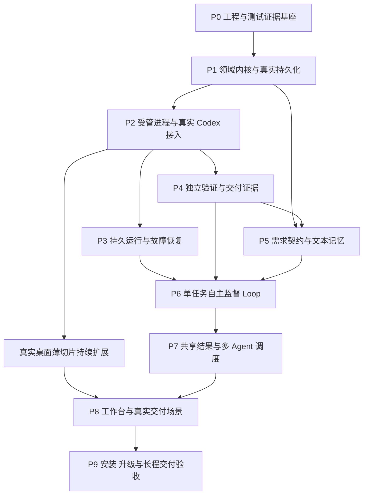

# Supervisor 开发计划

本计划按依赖从底层向上构建 Supervisor：先建立测试证据、领域规则和持久化，再接入真实执行、恢复与独立验证，然后开放自主 Loop、多 Agent 和完整桌面体验。每个阶段都交付可实际运行的能力，并通过本阶段的单元测试、真实组件集成及真实运行验收。

范围依据 [产品方案与技术架构](architecture.md)。P0 基座已完成真实运行与独立验收，71 项必要测试全部通过；P1–P9 尚未实施。已落地命令、验证结果与环境限制以 [README](../README.md) 为准；下文后续阶段仍为开发要求。产品为独立 macOS App，首接 Codex，工程交付为核心，资料整理和 deep research 同属首版。本文的 P0–P9 是施工顺序；PRD 的 M0–M3 是能力里程碑，不作为逐章开发顺序。

## 开发和验收的基本约束

1. **先有可信的检查，再让系统自主执行。** 开发测试工具从 P0 建立；产品独立验证器在 P4 建立；自主修正 Loop 在 P6 开放。不能让实现者自述成功成为完成判据。
2. **每阶段都运行真实系统。** 底层阶段运行真实数据库、文件系统、IPC 和进程；接入阶段必须运行真实 Codex；界面必须接真实后台；交付阶段必须实际构建、安装和操作产物。尚未实现的上层能力不计入本阶段完成范围。
3. **不以 mock 数据或替身作为阶段通过证据。** 不使用预设成功的执行器、伪造模型响应、静态事件回放或假后台数据证明系统可用。单元测试以明确输入和期望值运行真实生产逻辑；隔离数据库、测试账号和通过真实接口创建的业务记录用于避免影响用户数据，不替代真实实现。
4. **每阶段有完整的适用 Unit Test。** 按需求列出正常、边界、非法输入、错误处理、状态迁移和幂等性检查，不把“若干测试通过”或一个覆盖率百分比当作完整。进程、数据库、网络和模型行为另外通过集成及 live 测试证明。
5. **底层契约稳定后才扩大并行。** 模块之间通过版本化接口协作；共享 schema、数据库迁移、锁文件及最终集成由一个协调入口维护。未通过的依赖不能被 mock 结果解锁。
6. **界面从早期贯穿。** P2 就有连接真实后台的桌面薄切片；后续能力逐步接入。完整卡片工作台在 P8 集成，不能到最后才发现产品无法实际操作。
7. **失败必须留痕。** 不删用例、不降低必要覆盖、不放宽标准、不无限重跑刷绿。环境缺失就显示阻塞，未执行就显示未执行。

## 依赖与阶段交付



P3 与 P4 可在 P2 通过后并行；P5 的纯规则和文本读写可在 P1 后准备，但真实准入必须等待 P4 提供可执行验收条款。桌面、移动环境探测和研究材料准备可提前，最终放行仍按真实依赖。完成一条分支即可验证并解锁后继，不等待无关分支整批结束。

| 阶段 | 可运行交付物 | 必需前置 | 阶段门禁 |
| --- | --- | --- | --- |
| P0 | 环境探测、测试执行器、证据报告与失败门禁 | 无 | 正确执行真实命令并保留结果；故意失败、缺报告和零测试均拒绝通过 |
| P1 | 领域规则、SQLite 账本、产物发布及最小后台查询 | P0 | 真实写入、重启和故障事务后状态、事件、预算一致 |
| P2 | 进程控制、Codex 适配器、CLI 与真实桌面薄切片 | P1 | 一个真实任务产生可核对的产物；取消、窗口重连和预算拒绝有效 |
| P3 | RuntimeAdapter、检查点、恢复及 Temporal 选型结果 | P2 | 真实故障恢复不盲目重复副作用；运行时和正式部署路线已决定 |
| P4 | 独立验证器、固定候选及机器可判定完成条件 | P2 | 好产物通过，坏产物、失效证据和坏验收器均被正确拦截 |
| P5 | 需求准入、计划提案、项目内文本记忆和上下文构建 | P1、P4 | 歧义阻止正式写入，契约变更可追溯，新会话能依赖持久记忆继续 |
| P6 | 单任务执行、验证、修复、监控与模型升级闭环 | P3、P4、P5 | 真实任务发现缺陷后自主修复，按原标准复验后交付 |
| P7 | 资源调度、共享结果、并行分支与有界嵌套 Loop | P6 | 真实并行、资源冲突、分支阻塞、结果失效和最终集成均正确处理 |
| P8 | 完整工作台及工程、移动、整理、研究交付路径 | P7 及对应界面接口 | 各任务类型分别通过真实运行门禁，界面状态与后台事实一致 |
| P9 | 可安装桌面应用、后台管理、升级恢复及长程证据 | P8 | 从安装环境完成真实任务，并通过重启、升级、备份恢复和长程运行 |

## 模块边界和依赖方向

以下为建议目录，实施时建立；当前不是已有代码结构。

```text
apps/desktop                 Electron 与 React，展示和发送明确的用户操作
apps/supervisor              独立后台服务，组合领域规则与外部实现
apps/cli                     同一后台的命令行入口
packages/domain              契约、状态迁移、完成条件、预算与版本规则
packages/persistence         SQLite、迁移、事件、outbox/inbox、产物索引
packages/process-control     受管进程、身份核对、中断、资源操作
packages/executor-codex      Codex 协议、能力发现、事件归一化
packages/runtime             RuntimeAdapter 及选定的持久工作流实现
packages/verification        工程、UI、研究与交付验证
packages/context             分层文本、索引与 ContextManifest
packages/orchestration       需求、计划、Loop、调度及模型路由
packages/contracts           IPC 与模块间 schema
tests/unit                   真实模块实现的规则与边界断言
tests/integration            真实数据库、进程、IPC 与服务集成
tests/live                   真实 Codex、模型、公开来源及目标运行环境
tests/acceptance             冻结的阶段与产品门禁
```

domain 不依赖 Electron、Codex SDK 或 Temporal。桌面与 CLI 不直接改数据库或宣布任务成功。Temporal 不替代领域契约和证据；领域数据库不另行裁定同一工作流的计时与重试位置。开发测试执行器与产品验证器分离，避免产品错误同时污染自测判据。

## P0 工程与测试证据基座

**实现工作。** 建立仓库与 TypeScript 工程、固定工具链和依赖版本、模块约束、测试入口、case 清单及机器可读结果格式。只初始化缺失的仓库结构，保留当前文档及用户文件。提供环境探测：操作系统和架构、运行时、Codex 路径与版本、认证可用性、目录权限，以及 Android、iOS 和 Temporal 所需能力。探测不自动登录、安装大型工具链或修改全局设置。

**Unit Test。** case 清单解析、必需项对账、结果分类、版本和摘要校验、报告路径、失败退出码。覆盖零测试、缺少报告、重复 case ID、格式错误、过期报告和将阻塞误标为通过。

**真实运行验收。** 用测试执行器启动实际子进程，执行成功与故意失败的命令，写入和读取真实文件，采集 stdout/stderr、退出码与摘要。让命令中途失败、删除必需报告，确认顶层门禁失败；恢复正常输入后确认成功路径成立。不能仅测试报告页面能显示“通过”。

**输出与退出。** 环境能力清单、阶段 case manifest、结果 schema、实际红绿报告。未具备的移动环境按平台记录阻塞；不妨碍推进独立底层工作，也不能提前声称该平台可交付。P0 只证明开发与验收基座，不证明已接入 Agent。

## P1 领域内核与真实持久化

**实现工作。** 建立 TaskContract、Run、Node、Attempt、Criterion、Evidence、Budget、Lease、Operation、Event 的版本和状态规则；实现 SQLite 事务、数据库迁移、单写入口、事件游标、产物摘要和原子发布。后台提供最小本地 IPC 查询与操作接口。先实现派发前预算预留、累计结算和准入规则，后续所有模型调用共用它。

**Unit Test。** 合法和非法迁移、迟到或重复事件、取消后成功、证据失效、必要条款缺失、预算预留冲突、负额度拒绝、旧契约提交、无就绪任务的不同含义。纯函数用固定输入检查真实规则，不依赖供应商回答。

**真实运行验收。** 启动真实后台和独立 SQLite 文件，通过 IPC 创建契约、提交事件、发布文件并查询。分别在事务提交前后终止进程；重启后检查状态、事件与预算是否全有或全无。制造文件已写但索引未发布、数据库目录不可写等实际故障，确认半成品不解锁依赖，错误可定位。

**输出与退出。** 数据库迁移记录、事务前后快照、实际查询结果、重启日志和不变量断言。只有真实磁盘与进程重启通过才能进入 P2，内存数据库测试不足以放行。

## P2 受管进程与真实 Codex 接入

**实现工作。** 先建立操作意图、进程身份、工作区、受管进程组、中断与终止、超时、基础预算和验收额度预留，再启动首个真实模型调用。以一个真实本地长进程先验证控制链，再接 Codex app-server。实现版本/schema 检测、能力发现、事件归一化、独立会话和原始事件持久化。提供 supervisor CLI，以及能发起单次任务、看事件、取消、重连的桌面薄切片。

**Unit Test。** schema 校验、事件去重与排序、waiting 与 error/willRetry 的分类、未知协议字段、断连处理、取消竞态、PID 身份核对、预算不足拒绝派发。协议边界输入可以单独测试，但此类结果不计作供应商 live 事件已经覆盖。

**真实运行验收。** 在隔离的真实小工程中，让 Codex 完成一项明确代码修改；由开发测试工具实际运行构建和功能断言。保存真实 thread/turn、原始事件、diff、进程信息和用量状态。再从桌面取消运行、关闭窗口后重连、断开连接并恢复；用实际截图检验图像输入能力。无法稳定触发的供应商状态保留 live 覆盖缺口，不用手写事件冒充。

**输出与退出。** 真实 CLI 连接记录、产物与实际测试结果、桌面操作证据、取消和重连结果。要求已停止或已隔离的进程有核对证据；“发送了中断”不能证明任务已停止。此阶段只有受控单次执行，没有自主无限重试。

## P3 持久运行与故障恢复

**实现工作。** 建立 RuntimeAdapter、稳定 operationId、outbox/inbox、检查点、恢复核对和旧写者处理。优先用真实 Temporal Service 与 Worker 完成样板；LLM 与外部读写放在 Activity，工作流只控制可回放的编排。预算、授权、证据由领域层持有，运行时状态投影有版本。

**Unit Test。** 重复提交、重复回报、过期执行资格、取消后恢复、暂停派发、未知副作用、补偿条件、检查点版本不匹配和累计预算连续性。恢复不得只检查租约是否过期。

**真实运行验收。** 分别终止监督服务、Worker、Service；让真实测试服务已写入业务记录但执行结果尚未上报时终止 Worker。重启后查询实际记录：幂等操作只产生一次效果，无法核对的非幂等操作保持待核对且不自动重发。另验旧写者仍活跃、睡眠唤醒、取消传递和旧工作流历史兼容。

**选型门禁。** 在本阶段决定 Temporal 直接采用或延后，记录真实接入成本、后台资源、安装启动、升级和备份恢复路线。开发服务持久化只能证明样板，不等于正式部署通过。若延后，只实现相同门禁要求的本地持久运行能力，不同时维护两套完整引擎；新运行切换与在途运行迁移遵守 PRD 边界。不能把恢复问题推迟到 UI 完成后。

**输出与退出。** 故障注入位置、领域账本、执行历史、服务端实际效果、取消时间线及选型记录。选定实现必须通过恢复门禁；正式安装、升级和备份恢复在 P9 再从交付包验证。

## P4 独立验证与交付证据

**实现工作。** 实现固定候选快照、证据绑定、必要条款完成判定、验证器执行状态及失效传播。先接真实构建、测试和运行断言，再接实际 UI 操作与截图、多模态复核，以及真实材料的来源—结论核验。验证器使用独立上下文；验收标准与验收器实现分别版本化。

**Unit Test。** 通过、失败、无法判断、不适用及未运行/环境阻塞/验收器错误的组合；证据缺失、过期、版本不符、覆盖不足、验证期间候选变化；标准变化与验证器修复的不同处理。阶段门禁从冻结清单对账，不能由验证器自己删掉失败项。

**真实运行验收。** 对一个实际可运行的小工程先验收好版本，再植入功能缺陷，确认坏版本不通过；修改通过后的源码或二进制，确认旧证据失效。让验收器真实崩溃，确认不是产品失败也不是默认通过。对真实页面操作后截屏，不能只评审预制图片；对真实取得的材料，故意关联不支持结论的原文，确认复核拒绝。

**输出与退出。** 好坏版本、独立检查日志、实际操作和来源证据、标准/验证器摘要、失效路径。至少通过一组正向控制和一组负向控制；独立复核者检查门禁自身确实能够拒绝坏产物。P4 通过后才允许把验证结果交给自主 Loop。

## P5 需求契约与文本记忆

**实现工作。** 实现需求来源标注、必要澄清、设计基线、准入检查、契约变化和计划 schema。实现项目/模块/子模块文本记忆、更新提案、串行发布、来源和失效规则，以及 ContextManifest。根据目标和真实环境生成可执行验收项，不把模型自报置信度当准入条件。

**Unit Test。** 缺失验收条款拒绝、授权和范围越界、版本冲突、无效计划、同项目偏好继承、跨项目隔离、旧规则失效、摘要与原文引用、上下文超限和关键约束保留。具体上下文容量使用配置，先测行为而不是预填通用容量。

**真实运行验收。** 通过真实模型处理一个含糊目标，确认只产生澄清和允许的只读操作；补齐条件后生成可执行契约。让任务完成部分工作后终止原会话，从文本和账本启动新会话继续；核对关键约束、接口、失败原因和预算。加入过期记忆或其他项目偏好，确认行为不会误用。

**输出与退出。** 契约前后差异、真实请求/响应、工作区写入记录、记忆版本与 ContextManifest、新会话实际行为断言。不能用“提示词里写了要记住”证明记忆有效。

## P6 单任务自主监督 Loop

**实现工作。** 接通前置核对、执行、提交、独立验证、局部修复、检查点和完成判定。实现程序健康扫描、5 分钟 LLM 巡检、同窗口合并、上层诊断及质量优先模型路由；所有需求、监控、评审和修复调用进入同一预算。支持暂停、取消、预算停止和用户途中改需求。

**Unit Test。** 继续/完成/阻塞/停止判定、无进展指纹、策略补丁作用范围、检查合并、无变化跳过、睡眠后窗口合并、模型升级和深度选择、额度耗尽、会话替换不清零。测试调度规则可直接传入时间值，但不拿逻辑时间测试替代真实周期验收。

**真实运行验收。** 提交一项带有预先植入缺陷的实际工程任务，观察验证器发现缺陷、Codex 局部修复、按原标准复验及交付。另跑不能满足条件的任务，确认不会假成功。跨越至少三个真实 5 分钟巡检窗口，覆盖有变化检查、无变化跳过和再次检查；核对 10–15 秒健康扫描记录。错误修复及提交验收无需等待窗口。

**路由与停止验收。** 对明确复杂任务实际使用已选能力，在有依据的能力不足时允许一次失败后升级；记录可用模型和实际配置，缺少可用更强模型则标阻塞，不伪造升级成功。用真实运行触发总时限或尝试数上限，核对停止新派发、在途终止和预算连续性；不靠烧尽大量 token 测试预算。

**输出与退出。** 完整因果轨迹、有效验收、真实巡检时间线、路由记录、失败与修复 diff、预算和副作用状态。完成、不可修复、预算停止三类结果分别正确；只跑成功案例不能通过。

## P7 共享结果与多 Agent 调度

**实现工作。** 先实现 TaskResult 发布与最低依赖状态，再实现 worktree/非 Git 工作区、端口/数据库/模拟器租约和单一集成入口；随后实现 DAG、Sequence、Parallel、Loop、Verify、Gate、工具工作池和档位准入。计划补丁只修改获准的未开始节点；有界嵌套共享总预算与限制。

**Unit Test。** 环检测、依赖版本和验证门槛、未完整发布、迟到结果、重复认领、资源读写冲突、父子预算、深度/节点上限、档位集合包含、必需任务不被低档删除、单分支等待和全局阻塞区别。

**真实运行验收。** 两个真实 Codex 尝试在不同工作区修改互不依赖模块，保存重叠执行时间线；串行集成后实际运行最终测试。再让两分支争用同一真实资源，确认排队或隔离。阻塞其中一条依赖，观察无关分支继续；让旧尝试迟到提交，确认不能覆盖当前结果。至少运行一个顺序与并行组合、一个有界嵌套 Loop，并触发其上限。

**效率验收。** 在相同冻结任务、输入和验收标准下比较串行与并行的实际交付时间、等待、重复工作和可测用量；记录所有尝试及环境差异，不用一次偶然快证明普遍提速。收益不足时调整工作粒度或工作池，不能仅以 Agent 数增加宣布并行成功。五来源任务保留五项结果，不强制五个 Agent。

**输出与退出。** 任务图、真实并行与租约时间线、共享结果版本、集成后证据、档位原因和比较记录。多 Agent 已退出但集成失败时，整体必须保持未完成。

## P8 完整工作台与真实交付场景

本阶段按下表并行推进独立工作包；资源冲突仍须排队。工作台开发从 P2 持续进行，接入一项能力就验证一项实际交互，不等待所有场景结束才做 UI。每个工作包单独报告通过、失败或阻塞，不能以其他工作包通过抵消缺口。

| 工作包 | Unit Test 与模块检查 | 真实运行及交付门禁 |
| --- | --- | --- |
| P8U 桌面工作台 | 状态投影、筛选/分组、3:4 布局计算、输入作用范围、事件游标、错误与等待展示 | 通过真实后台创建、暂停、恢复、取消任务；悬浮/固定详情、查看证据、打开产物；断开后台后显示真实错误，重连后与数据库一致，不回退假数据 |
| P8E 工程并行交付 | API 契约兼容、集成顺序、候选固定、证据失效 | 在一个实际全栈小项目中并行开发前后端，连接真实实现的服务和数据库，完成写入、读取、错误处理与重开；再从交付快照构建和运行 |
| P8M 移动交付 | 工具链结果解析、平台/设备绑定、构建安装状态、UI 用例覆盖和模拟器资源排他 | 对契约要求的平台真实构建：Android APK 安装启动；iOS 模拟器 .app 安装启动；完成核心操作与持久化，关闭后按交付说明重新打开；分别保存平台证据 |
| P8R 公开研究 | 来源规范化、版本/时效、同源去重、Claim 对应、缺口和停止条件 | 实际读取约五个合适公开来源，包含并行获取/总结、去重和独立核验；故意关联不支持结论的真实原文、过时来源或同源转载，验证纠错；交付原文可追溯报告 |
| P8D 资料整理 | 材料覆盖、索引、重复映射、无法解析和部分失败 | 使用真实文档材料完成分类、去重与摘要；逐项核对原文和索引，未处理内容明确保留，不靠文件数量证明完整 |

UI 验收按页面、必要状态、功能点与关键操作拆分，检查按钮是否明显、反馈是否正确、导航与数据流是否连贯；截图与实际状态断言结合，不逐像素比对。Supervisor 自动操作、截图与归纳，不要求用户逐条确认。

移动环境在 P0 探测、P2–P4 做能力样板；P8 才做完整受监督交付。Android 与 iOS 分别设置门禁，声明支持的全部平台必须通过；环境缺失就保留对应阻塞，不能暗中缩减支持范围，也不能把单平台结果表述为双平台通过。公开研究使用真实网络与来源；真实抓取的版本快照可用于回归，但不能冒称本轮重新抓取。

## P9 安装 升级与长程交付验收

**实现工作。** 打包桌面、独立监督服务和所需运行时；实现用户级后台管理、真实路径发现、数据迁移、工作流版本兼容、备份恢复、日志保留与错误诊断。区分关闭窗口、退出界面、暂停任务和停止后台。完成安装后再用产品本身执行任务。

**Unit Test。** 配置和路径解析、安装状态迁移、版本兼容选择、数据库迁移计划、备份元数据、恢复前置条件、清理规则和用户选择持久化。数据库迁移与恢复另用实际旧版本数据执行，不只校验 SQL 字符串。

**真实运行验收。** 从打包应用启动，移除对开发终端 PATH 和工作目录的依赖；连接实际 Codex 并交付一项真实任务。关闭窗口、停止后台、重启系统或重新登录后，按暂停/取消状态正确核对恢复。使用真实旧版本运行数据执行应用升级；备份后在隔离位置恢复，核对数据库、产物和运行时历史的对应关系。恢复不得盲目重新启动外部动作。

**长程门禁。** 首版暂以至少一次跨夜、持续 8 小时以上的运行观察作为覆盖下限，期间包含真实任务执行、持久等待、恢复和后续工作；不要求模型持续调用，也不接受空转计时替代。记录活跃期与等待期、任务推进、内存、日志增长、调用与异常。该时长是拟定测试门槛，不是可靠性承诺；若样板表明需要更长观察，在运行前调整清单并说明原因。

**输出与退出。** 安装包与摘要、启动说明、版本及支持矩阵、升级/恢复证据、长程报告、实际交付样本、已知限制。必要门禁全部通过才标记首版可用；仅开发模式正常不算安装交付完成。外部分发的签名、公证按分发范围另验，不能用个人本机启动结果冒充广泛兼容。

## 测试证据和阶段门禁协议

每阶段开始前冻结需求—测试清单，包含 case ID、关联条款、测试层、前置条件、操作、预期结果、必要属性、证据要求及清理方式。清单与产物、验收器分别版本化。规则测试覆盖本阶段所有已声明行为及关键不变量，覆盖率用于寻找遗漏，不设虚假的统一 100% 完成承诺。

开发入口如下；P0 已落实工程与阶段检查，live 与 release 在对应能力实现前明确非零退出，不能表示通过：

| 入口 | 职责 |
| --- | --- |
| `pnpm test:unit` | 运行真实领域和模块实现的单元测试，导出逐项结果 |
| `pnpm test:integration` | 启动真实本地依赖，验证数据库、进程、IPC 与服务行为 |
| `pnpm test:live` | 使用真实 Codex、模型和所需外部能力，缺失能力明确失败或阻塞 |
| `pnpm verify:stage` | 按选定阶段的冻结清单执行并对账证据；必要项缺失时非零退出 |
| `pnpm verify:release` | 对固定安装候选执行全部适用交付门禁，不能只聚合历史绿灯 |

阶段、配置及运行标识的具体参数由 P0 统一定义。快速开发可只运行受影响测试；阶段提交时必须完整运行本阶段必需清单，以及受本次变化影响的上游回归。模型或外部服务不可用时，不静默退回模拟执行器。

每次验证输出独立目录，建议置于项目的 `.supervisor-dev/verification/<run-id>/`，与被监督任务产物分开：

```text
manifest.json          候选与清单摘要、标准/验证器版本、环境和实际依赖
results.json           每条 case 的预期、实际、状态、证据引用和失败原因
junit.xml              测试报告，便于工具读取
summary.html           可直接打开的报告，连接到逐项原始证据
events.jsonl           实际执行与故障注入时间线
logs/                  stdout、stderr、启动/结束与退出记录
artifacts/             diff、查询结果、截图、实际输出及内容摘要
```

真实执行证据需交叉核对：命令和受管进程身份、起止时间、真实事件、实际数据库/文件/服务状态、断言及产物摘要相互对应。仅写一个 `real=true` 字段、模型总结或命令退出码 0 不够。报告不保存凭证；删去敏感值不影响必要状态核对。

门禁必须逐项满足：必要 case 全部执行并通过；没有缺失、未运行、未解释的 skip、阻塞或验收器错误；证据匹配当前固定候选与环境；受影响回归通过；已知失败已由具体修复及复验证据关闭；独立评审完成。预先不适用的项目须有范围依据，不能运行失败后临时改成不适用。

报告同时显示必需总数、已执行、通过、失败、阻塞、未运行和不适用数量，以及历史失败、重跑理由与实际配置。故障测试分开显示“检测能力测试通过”和“坏候选验收失败”，避免一片绿色掩盖判定对象。

同一候选和环境的运行记录追加保存，不覆盖失败。重跑记录实现修复、环境修复或无变化重试的原因；偶然一次通过不自动关闭不稳定缺陷。可重复次数与判据在用例执行前设定，不临时跑到绿为止。LLM 任务验证行为与证据，不要求输出措辞逐字相同，也不以模型自评分当稳定性指标。

独立复核者从冻结契约检查反例、原始证据，并重新运行关键的可重复操作。不可重复的外部动作核对实际凭证，不为复核盲目重发。实现者可以写单测，不能单独批准自己的验收器修复；修复必须同时保持应通过与应拒绝样本的正确结果。相同系统权限下，版本、摘要和独立进程是可追溯约束，不宣称防恶意篡改隔离。

## 必须让系统失败的真实实验

以下是跨阶段回归清单，所有故障注入限定在受管测试目录、进程和服务中。

| 编号 | 实际操作 | 必须观察到的结果 | 首次阶段 |
| --- | --- | --- | --- |
| F01 | 删除必要测试报告、让测试只发现零个用例 | 顶层门禁非零退出，缺口可见 | P0 |
| F02 | 事务提交前后终止真实后台、制造数据库不可写 | 状态/事件/预算无半提交，不默认成功 | P1 |
| F03 | 取消真实 Codex，随后收到迟到完成事件 | 原取消状态不复活，进程停止或隔离可核对 | P2 |
| F04 | 后台重启但旧子进程持续写文件 | 新尝试不抢占同一资源，先核对并停止或隔离旧写者 | P3 |
| F05 | 真实服务已写入，Activity 回报前终止 Worker | 幂等动作效果不重复；未知非幂等效果不盲目重发 | P3 |
| F06 | 修改已验证源码/二进制、删除证据或在验证中写入 | 旧通过失效，固定候选不能交付 | P4 |
| F07 | 验收器崩溃，或删必要项/放宽阈值/更换假服务 | 门禁阻断并区分原因；不靠改标准获得绿灯 | P4 |
| F08 | 替换真实模型会话，加入过期或跨项目记忆 | 关键约束保留，旧知识不误用，预算和副作用记录连续 | P5 |
| F09 | 实际运行触及时限/次数上限，或必需条款无法满足 | 停止或阻塞，产物保持未完成，不自动提高额度 | P6 |
| F10 | 真实分支争用资源、旧结果迟到、上游版本改变 | 排队/隔离、拒绝旧提交、失效传播，无关任务继续 | P7 |
| F11 | UI 断开真实后台、必需服务停机、移动核心路径出错 | 错误与缺口真实显示；截图或构建成功不能放行 | P8 |
| F12 | 研究结论引用不支持它的真实原文、同源转载充数 | 识别不支持及重复，修正结论或保留缺口 | P8 |
| F13 | 真实旧版本数据升级、备份恢复或长期运行后重连 | 状态与产物可核对，无丢任务、隐式重发或假恢复 | P9 |

## 工作包组织与首批执行顺序

首批只展开基础工作，避免一次生成全部实现后再总体验收。

| 工作包 | 交付 | 前置与协作边界 |
| --- | --- | --- |
| B01 | 工程入口、固定工具链、模块依赖约束 | P0 起点；共享配置由单一集成者维护 |
| B02 | 冻结测试清单、真实执行报告与失败门禁 | B01；可与 B03 并行准备 |
| B03 | 真实环境探测及支持矩阵 | B01；只读探测，不自行安装工具链 |
| B04 | 领域对象、状态与完成/预算规则及 Unit Test | B02 的 schema 稳定后；不依赖 UI 和供应商 |
| B05 | SQLite 事务、迁移、事件、发布与故障集成测试 | B04 的接口版本；与底层 IPC 按契约协作 |
| B06 | 最小后台、IPC、CLI 和查询能力 | B04；最终验收依赖 B05 |
| B07 | 受管进程、取消、时间限制与执行意图 | P1 通过后；先用真实本地进程验收 |
| B08 | Codex 单次真实执行与桌面薄切片 | B07 通过后；能力与原始事件进入账本 |

P2 后，恢复/Temporal 与独立验证器可以分别推进；P4 内的工程检查、UI 操作能力和研究验证可以按接口并行。各自使用独立工作区、数据库、端口与证据目录；共享模拟器、锁文件、schema 和最终合并串行处理。用户无需因每阶段通过再次确认常规开发动作，只有范围、授权或必要业务标准改变才重新对齐。

不预先虚构日历工期或并行提速比例。P0–P2 记录真实实现、等待、验证和返工成本后，再估计后续工作包；依赖顺序和门禁不会为赶进度删除。首版发布仍需工程交付、研究整理、声明的移动平台、真实工作台与恢复证据全部满足，不能用单个漂亮演示替代。

## 当前状态与下一步

P0 的 B01–B03 已完成并通过独立验收，真实测试证据与状态见 README。P1–P9 均未实施。下一阶段从 B04–B06 开始，建立领域规则、SQLite 持久化与最小后台；不得用 P0 的通过结果替代 P1 验收。
