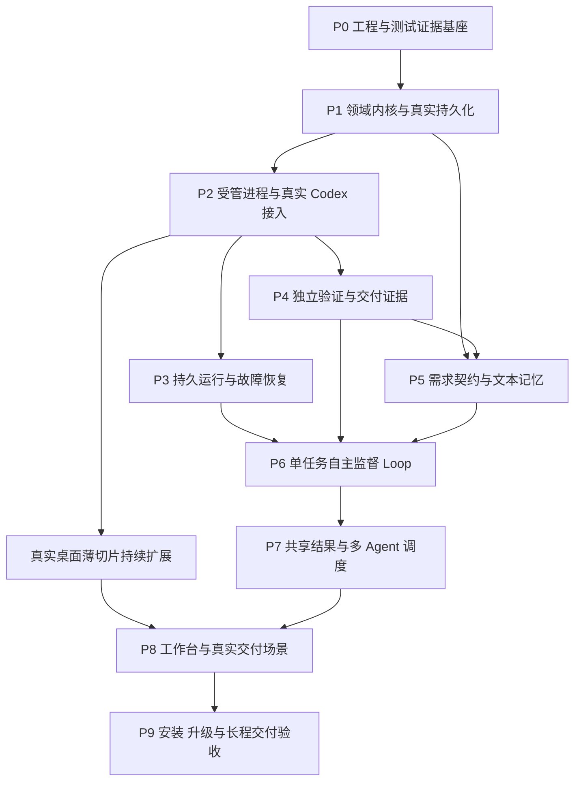

# Supervisor 开发计划

本计划按依赖从底层向上构建 Supervisor：先建立测试证据、领域规则和持久化，再接入真实执行、恢复与独立验证，然后开放自主 Loop、多 Agent 和完整桌面体验。每个阶段都交付可实际运行的能力，并通过本阶段的单元测试、真实组件集成及真实运行验收。

范围依据 [产品方案与技术架构](architecture.md)。P0、P1 已完成真实运行与独立验收；P2 受管进程、真实 Codex 与桌面薄切片已完成真实运行验收与独立复核。P3 local-v1 已实现，205 项自动检查及桌面交互已通过，按用户明确的系统持续运行/仅息屏使用范围交付；系统睡眠恢复未验证且不在当前承诺内，P4 独立验证器已通过 231 项真实自动检查、桌面操作及独立门禁审查，P5 需求主控、准入与文本记忆已完成真实运行与独立验收；P6 正在构建持续跟进与监督策略的底层，完整门禁尚未通过；P7 已接通共享结果、持久并行派发、完整输入传递和最终集成边界，已有隔离版本的真实并行交付证据及宿主安装嵌套 Loop 组件证据，普通 P5 并行、有界循环及可选探索已接入机制层，完整 P7 门禁尚未通过；P8 工作台、移动宿主与资料接收正在隔离开发，未形成阶段交付；P9 尚未实施。已落地命令、验证结果与环境限制以 [README](../README.md) 为准；下文后续阶段仍为开发要求。产品为独立 macOS App，首接 Codex，工程交付为核心，资料整理和 deep research 同属首版。本文的 P0–P9 是施工顺序；PRD 的 M0–M3 是能力里程碑，不作为逐章开发顺序。

## 当前执行范围：个人实地试用

2026-10-11 用户明确授权缩减 P6–P8 审核，同时记录未验范围和风险。当前执行以 [精简验收与实地补验](field-validation.md) 及 `tests/acceptance/p6.json`、`p7.json`、`p8.json` 为准：默认完整 suite 展开分别为 **50 / 47 / 51** 项，跨阶段去重为 **140** 项。旧清单存档于 `tests/acceptance/extended/`，逐项延期及原始版本记录于 `tests/acceptance/deferred-p6-p8.json`。

2026-10-12 的当前最小跟进样板 core v6 只承诺直接业务API、必要文件和真实脚本成功，仍须真实跟进、重启、两次代码执行、独立 P4 与交付。用户测试质量、依赖/框架资格与追加契约后的动态作者组合分别延期。自主修复样板供应初始验收资产，通过真实独立审核发布后接入监督；初始自动作者三段及其恢复组合延期，真实业务缺陷、模型修复、修复后的动态必要回归维护、发布和交付保持。第四条只验当前双文件清单，不宣称已证明“无额外功能”或历史过程。所有旧FAIL及更宽范围保留；这不是产品通用能力禁令或自动作者成功的证据。

当前缩减与延期记录已逐项核对完成；必要集139项有适用范围内的通过证据，L01仍失败。565dbe7真实修复成功，但维护新revision的输出schema仅允许空参数，与必须保留原参数的要求冲突；该产品缺陷未修，不能宣告个人门禁通过。详见实地补验记录。

下文原完整门禁和历史检查点保留为长期设计与证据，不再自动作为当前个人试用的全部前置条件。保留的 P6 真实在途跟进/恢复/交付、自主修复，以及 P7 真实并行集成交付仍需实际通过；组件测试不能替代它们。移动双平台完整样板、原生 UI 全矩阵、多代研究和效率对照等延期项在实地触发时按风险补验。旧失败仍是失败，阶段目前仍为 developing；范围调整不降低 Supervisor 对用户项目的业务验收要求。

## 开发和验收的基本约束

1. **先有可信的检查，再让系统自主执行。** 开发测试工具从 P0 建立；产品独立验证器在 P4 建立；自主修正 Loop 在 P6 开放。不能让实现者自述成功成为完成判据。
2. **每阶段都运行真实系统。** 底层阶段运行真实数据库、文件系统、IPC 和进程；接入阶段必须运行真实 Codex；界面必须接真实后台；交付阶段必须实际构建、安装和操作产物。尚未实现的上层能力不计入本阶段完成范围。
3. **不以 mock 数据或替身作为阶段通过证据。** 不使用预设成功的执行器、伪造模型响应、静态事件回放或假后台数据证明系统可用。单元测试以明确输入和期望值运行真实生产逻辑；隔离数据库、测试账号和通过真实接口创建的业务记录用于避免影响用户数据，不替代真实实现。
4. **每阶段有完整的适用 Unit Test。** 按需求列出正常、边界、非法输入、错误处理、状态迁移和幂等性检查，不把“若干测试通过”或一个覆盖率百分比当作完整。进程、数据库、网络和模型行为另外通过集成及 live 测试证明。
5. **底层契约稳定后才扩大并行。** 模块之间通过版本化接口协作；共享 schema、数据库迁移、锁文件及最终集成由一个协调入口维护。未通过的依赖不能被 mock 结果解锁。
6. **界面从早期贯穿。** P2 就有连接真实后台的桌面薄切片；后续能力逐步接入。完整卡片工作台在 P8 集成，不能到最后才发现产品无法实际操作。
7. **失败必须留痕。** 不为获得通过而删除失败用例、降低必要覆盖、放宽标准或无限重跑刷绿。允许按全局测试库的生命周期规则新增、修改、合并及退役用例，保留理由和替代关系；冻结后的单次运行不能临时减少必需项。环境缺失就显示阻塞，未执行就显示未执行。

## 依赖与阶段交付



P3 与 P4 可在 P2 通过后并行；P5 的纯规则和文本读写可在 P1 后准备，但真实准入必须等待 P4 提供可执行验收条款。桌面、移动环境探测和研究材料准备可提前，最终放行仍按真实依赖。完成一条分支即可验证并解锁后继，不等待无关分支整批结束。

| 阶段 | 可运行交付物 | 必需前置 | 阶段门禁 |
| --- | --- | --- | --- |
| P0 | 环境探测、测试执行器、证据报告与失败门禁 | 无 | 正确执行真实命令并保留结果；故意失败、缺报告和零测试均拒绝通过 |
| P1 | 领域规则、SQLite 账本、产物发布及最小后台查询 | P0 | 真实写入、重启和故障事务后状态、事件、预算一致 |
| P2 | 进程控制、Codex 适配器、CLI 与真实桌面薄切片 | P1 | 一个真实任务产生可核对的产物；取消、窗口重连和预算拒绝有效 |
| P3 | RuntimeAdapter、检查点、恢复及 Temporal 选型结果 | P2 | 真实故障恢复不盲目重复副作用；运行时和正式部署路线已决定 |
| P4 | 独立验证器、项目用例维护、固定清单/候选及完成条件 | P2 | 好产物通过，坏产物、失效证据和坏验收器被拦截；用例替换保留必要覆盖 |
| P5 | 需求准入、计划提案、项目内文本记忆和上下文构建 | P1、P4 | 歧义阻止正式写入，契约变更可追溯，新会话能依赖持久记忆继续 |
| P6 | 单任务执行、验证、修复、监控与模型升级闭环 | P3、P4、P5 | 真实任务发现缺陷后自主修复，按原标准复验后交付 |
| P7 | 资源调度、共享结果、并行分支与有界嵌套 Loop | P6 | 真实并行、资源冲突、分支阻塞、结果失效和最终集成均正确处理 |
| P8 | 完整工作台及工程、移动、整理、研究交付路径 | P7 及对应界面接口 | 各任务类型分别通过真实运行门禁，界面状态与后台事实一致 |
| P9 | 可安装桌面应用、后台管理、升级恢复及长程证据 | P8 | 从安装环境完成真实任务，并通过重启、升级、备份恢复和长程运行 |

## 模块边界和依赖方向

以下为完整目标目录。P0–P2 已建立 contracts、domain、persistence、process-control、executor-codex、execution、桌面、后台、CLI 及研发测试目录；P3 已增加 runtime 和独立 runtime-worker，P4 已增加 verification 与隔离页面验收进程，其余模块按后续阶段实现。已落地范围见 README。

```text
apps/desktop                 Electron 与 React，展示和发送明确的用户操作
apps/supervisor              独立后台服务，组合领域规则与外部实现
apps/runtime-worker          持久运行 Worker，核对旧执行并派发 Activity
apps/cli                     同一后台的命令行入口
packages/domain              契约、状态迁移、完成条件、预算与版本规则
packages/persistence         SQLite、迁移、事件、outbox/inbox、产物索引
packages/process-control     受管进程、身份核对、中断、资源操作
packages/executor-codex      Codex 协议、能力发现、事件归一化
packages/runtime             RuntimeAdapter 及选定的持久工作流实现
packages/verification        项目用例库、变更复核、选择/冻结及工程、UI、研究验证
packages/context             分层文本、索引与 ContextManifest
packages/orchestration       需求、计划、Loop、调度及模型路由
packages/contracts           IPC 与模块间 schema
tests/unit                   真实模块实现的规则与边界断言
tests/integration            真实数据库、进程、IPC 与服务集成
tests/live                   真实 Codex、模型、公开来源及目标运行环境
tests/catalog                全局用例登记、覆盖关系与维护记录（P1 已建立）
tests/acceptance             引用全局用例的阶段/发布配置；执行时冻结清单
```

domain 不依赖 Electron、Codex SDK 或 Temporal。桌面与 CLI 不直接改数据库或宣布任务成功。Temporal 不替代领域契约和证据；领域数据库不另行裁定同一工作流的计时与重试位置。开发测试执行器与产品验证器分离，避免产品错误同时污染自测判据。

## P0 工程与测试证据基座

**实现工作。** 建立仓库与 TypeScript 工程、固定工具链和依赖版本、模块约束、测试入口、case 清单及机器可读结果格式。只初始化缺失的仓库结构，保留当前文档及用户文件。提供环境探测：操作系统和架构、运行时、Codex 路径与版本、认证可用性、目录权限，以及 Android、iOS 和 Temporal 所需能力。探测不自动登录、安装大型工具链或修改全局设置。

**Unit Test。** case 清单解析、必需项对账、结果分类、版本和摘要校验、报告路径、失败退出码。覆盖零测试、缺少报告、重复 case ID、格式错误、过期报告和将阻塞误标为通过。

**真实运行验收。** 用测试执行器启动实际子进程，执行成功与故意失败的命令，写入和读取真实文件，采集 stdout/stderr、退出码与摘要。让命令中途失败、删除必需报告，确认顶层门禁失败；恢复正常输入后确认成功路径成立。不能仅测试报告页面能显示“通过”。

**输出与退出。** 环境能力清单、阶段 case manifest、结果 schema、实际红绿报告。未具备的移动环境按平台记录阻塞；不妨碍推进独立底层工作，也不能提前声称该平台可交付。P0 只证明开发与验收基座，不证明已接入 Agent。

## P1 领域内核与真实持久化

**实现工作。** 建立 TaskContract、Run、Node、Attempt、Criterion、Evidence、Budget、Lease、Operation、Event 的版本和状态规则；实现 SQLite 事务、数据库迁移、单写入口、事件游标、产物摘要和原子发布。后台提供最小本地 IPC 查询与操作接口。先实现派发前预算预留、累计结算和准入规则，后续所有模型调用共用它。

同时建立受监督项目的 VerificationCase/VerificationCatalog、VerificationChange 与 VerificationPlan 最小记录：项目隔离、修订、覆盖/替代关系、冻结定义、发布状态和证据引用。这里只实现领域与存储约束，产品的选择、复核与执行机制在 P4 接通；与 Supervisor 研发测试登记分开保存。

**Unit Test。** 合法和非法迁移、迟到或重复事件、取消后成功、证据失效、必要条款缺失、预算预留冲突、负额度拒绝、旧契约提交、无就绪任务的不同含义。纯函数用固定输入检查真实规则，不依赖供应商回答。

**真实运行验收。** 启动真实后台和独立 SQLite 文件，通过 IPC 创建契约、提交事件、发布文件并查询。分别在事务提交前后终止进程；重启后检查状态、事件与预算是否全有或全无。制造文件已写但索引未发布、数据库目录不可写等实际故障，确认半成品不解锁依赖，错误可定位。

**输出与退出。** 数据库迁移记录、事务前后快照、实际查询结果、重启日志和不变量断言。只有真实磁盘与进程重启通过才能进入 P2，内存数据库测试不足以放行。

用例记录同样验收跨项目隔离、修订不可覆盖、替代后缺陷引用不丢失，以及快照文件与库指针/覆盖关系的原子发布；真实终止进程后不能读取半发布定义。

**落地状态。** B04–B06 已完成，包含全局研发用例登记与 P0/P1 配置迁移。完整验收 152/152，独立复跑 62/62。P1 预算使用安全整数 `work-unit` 记账，资源租约按精确键互斥；尚不代表供应商计费或操作系统进程控制。证据录入和用例发布属于受信本地 API，独立语义验证仍由 P4 提供。

## P2 受管进程与真实 Codex 接入

**实现工作。** 先建立操作意图、进程身份、工作区、受管进程组、中断与终止、超时、基础预算和验收额度预留，再启动首个真实模型调用。以一个真实本地长进程先验证控制链，再接 Codex app-server。实现版本/schema 检测、能力发现、事件归一化、独立会话和原始事件持久化。提供 supervisor CLI，以及能发起单次任务、看事件、取消、重连的桌面薄切片。任务按真实项目目录分组，移除全局运行历史入口；未指定路径时自动创建 `~/.supervisor/workspace/<稳定标识>` 并持续保留。验收包括路径规范化、同项目归组、无路径创建、请求幂等重试和重启后的目录/文件保留。

**Unit Test。** schema 校验、事件去重与排序、waiting 与 error/willRetry 的分类、未知协议字段、断连处理、取消竞态、PID 身份核对、预算不足拒绝派发。协议边界输入可以单独测试，但此类结果不计作供应商 live 事件已经覆盖。

**真实运行验收。** 在隔离的真实小工程中，让 Codex 完成一项明确代码修改；由开发测试工具实际运行构建和功能断言。保存真实 thread/turn、原始事件、diff、进程信息和用量状态。再从桌面取消运行、关闭窗口后重连、断开连接并恢复；用实际截图检验图像输入能力。无法稳定触发的供应商状态保留 live 覆盖缺口，不用手写事件冒充。

**输出与退出。** 真实 CLI 连接记录、产物与实际测试结果、桌面操作证据、取消和重连结果。要求已停止或已隔离的进程有核对证据；“发送了中断”不能证明任务已停止。此阶段只有受控单次执行，没有自主无限重试。

**落地实现。** 本阶段使用 Node 24.20.0 独立后台、Electron 44.7.0/React 19.3.0 桌面与 Codex 0.153.4 app-server。真实账户模型能力、原始事件、thread/turn、token 用量、停止观察及候选文件摘要进入账本。P2 全局配置 180 项按稳定 ID 去重，其中 3 项真实模型门禁验证工程修复与独立构建、取消及真实截图。桌面另外验证启动、断开、窗口关闭重开和取消；正式结果以 README 的最终候选证据为准。

进程控制核对继承 token 的原进程组与 detached 子进程，包括实际替代进程链；不宣称可以限制主动清除 token 的恶意进程或外部任务。预算是上报后的原始 token 观察上限，不是供应商强制金额上限。P2 重启只核对并停止旧执行，不自动续跑；`Execution.completed` 不使领域任务验收成功。异常供应商状态未稳定触发的部分仍明确保留 live 覆盖缺口。

## P3 持久运行与故障恢复

**实现工作。** 建立 RuntimeAdapter、稳定 operationId、outbox/inbox、检查点、恢复核对和旧写者处理。优先用真实 Temporal Service 与 Worker 完成样板；LLM 与外部读写放在 Activity，工作流只控制可回放的编排。预算、授权、证据由领域层持有，运行时状态投影有版本。

**Unit Test。** 重复提交、重复回报、过期执行资格、取消后恢复、暂停派发、未知副作用、补偿条件、检查点版本不匹配和累计预算连续性。恢复不得只检查租约是否过期。

**真实运行验收。** 分别终止监督服务、Worker、Service；让真实测试服务已写入业务记录但执行结果尚未上报时终止 Worker。重启后查询实际记录：幂等操作只产生一次效果，无法核对的非幂等操作保持待核对且不自动重发。另验旧写者仍活跃、取消传递和旧工作流历史兼容。2026-10-10 用户明确仅息屏、不让系统睡眠，真实整机睡眠/唤醒从当前个人使用范围移出，保留未验证记录；重新承诺系统睡眠支持时必须恢复该实际门禁。

**选型门禁。** 在本阶段决定 Temporal 直接采用或延后，记录真实接入成本、后台资源、安装启动、升级和备份恢复路线。开发服务持久化只能证明样板，不等于正式部署通过。若延后，只实现相同门禁要求的本地持久运行能力，不同时维护两套完整引擎；新运行切换与在途运行迁移遵守 PRD 边界。不能把恢复问题推迟到 UI 完成后。

**输出与退出。** 故障注入位置、领域账本、执行历史、服务端实际效果、取消时间线及选型记录。选定实现必须通过恢复门禁；正式安装、升级和备份恢复在 P9 再从交付包验证。

用例维护纳入恢复样板：在发布前后终止服务，重启后核对库版本、覆盖关系和变更记录一致；验证任务恢复仍引用原冻结清单，不从最新库重选。回退定义不清空失败、预算或副作用记录。P3 先检查 P1 的真实持久化与恢复，P4 接通验证执行后补齐在途版本更新的集成场景。

## P4 独立验证与交付证据

**实现工作。** 实现固定候选快照、证据绑定、必要条款完成判定、验证器执行状态及失效传播。先接真实构建、测试和运行断言，再接实际 UI 操作与截图、多模态复核，以及真实材料的来源—结论核验。验证器使用独立上下文；验收标准与验收器实现分别版本化。

**Unit Test。** 通过、失败、无法判断、不适用及未运行/环境阻塞/验收器错误的组合；证据缺失、过期、版本不符、覆盖不足、验证期间候选变化；标准变化与验证器修复的不同处理。阶段门禁从冻结清单对账，不能由验证器自己删掉失败项。

**真实运行验收。** 对一个实际可运行的小工程先验收好版本，再植入功能缺陷，确认坏版本不通过；修改通过后的源码或二进制，确认旧证据失效。让验收器真实崩溃，确认不是产品失败也不是默认通过。对真实页面操作后截屏，不能只评审预制图片；对真实取得的材料，故意关联不支持结论的原文，确认复核拒绝。

**输出与退出。** 好坏版本、独立检查日志、实际操作和来源证据、标准/验证器摘要、失效路径。至少通过一组正向控制和一组负向控制；独立复核者检查门禁自身确实能够拒绝坏产物。P4 通过后才允许把验证结果交给自主 Loop。

**项目用例维护。** 实现 [产品用例迭代机制](architecture.md#测试与验收用例的持续迭代)：变更提案、独立复核、版本发布、影响选择和本轮冻结，绑定条款、用例、验证器、数据/夹具、候选及环境。Unit Test 检查替代覆盖缺口、改预期绕过契约、必要参数被错误去重、失败引用迁移、旧证据失效和未经发布的测试文件变更。

真实运行使用同一可运行工程的正常版本与已知缺陷版本：合并重复成功路径后仍能拒绝原缺陷；故意去掉必要异常断言或照抄错误输出作为预期时，维护不能发布。另修改测试数据或验证器、在验证中发布新库版本，确认固定清单不变、旧结果不误用于新定义。保留旧新映射、复核过程及实际反例结果；少量反例是检测证据，不宣称证明任意输入下等价。

**落地实现。** P4 已接入同一后台控制器、CLI 和桌面六步操作：定义提案、实际正负控制与独立语义复核、发布、冻结、独立执行和当前交付核对。实现固定 TypeScript 工具链独立编译与输出比对、本地 HTML 页面真实操作/截图/多模态复核、实际 HTTPS 原文与结论核验。项目用例修订与在途清单隔离，预算和恢复沿用同一 Run；源码、检查器、环境或证据变化使当前交付失效。实际结果以 README 最终冻结记录为准。

当前仍需调用方提供 JSON 定义；P5 负责需求与记忆，P6 才自动编排验收和修复。UI 验证暂限本地 HTML，固定构建暂限声明的 TypeScript 项目；Android/iOS、通用联网研究流程和安装包生命周期属于后续阶段。全配置摘要绑定是保守策略，Codex 配置内容变化即要求新环境复核；未存分量摘要时不应凭总摘要变化推断具体原因。

## P5 需求契约与文本记忆

**实现工作。** 建立 `SupervisorReasoner` 与首个 `CodexReasonerAdapter`，直接启动本机受管 Codex app-server，默认复用可用认证；统一主控用途、独立上下文、结构化结果、取消、预算和原始证据。模型只生成提案，控制器执行合法动作，不另建通用模型代理或接管用户的 Codex 窗口。实现需求来源标注、必要澄清、设计基线、准入检查、契约变化和计划 schema。实现项目/模块/子模块文本记忆、更新提案、串行发布、来源和失效规则，以及 ContextManifest。根据目标和真实环境生成可执行验收项，不把模型自报置信度当准入条件。

**Unit Test。** 缺失验收条款拒绝、授权和范围越界、版本冲突、无效计划、同项目偏好继承、跨项目隔离、旧规则失效、摘要与原文引用、上下文超限和关键约束保留。具体上下文容量使用配置，先测行为而不是预填通用容量。

**真实运行验收。** 通过实际本机 Codex 主控会话处理一个含糊目标，确认只产生澄清和允许的只读操作；补齐条件后生成可执行契约与计划，核对结构化提案经过控制器而非模型直接改写运行状态；主控调用与执行、验收共用同一账本，未知用量不记零。让任务完成部分工作后终止原会话，从文本和账本启动新会话继续；核对关键约束、接口、失败原因和预算。加入过期记忆或其他项目偏好，确认行为不会误用。

**输出与退出。** 契约前后差异、真实请求/响应、工作区写入记录、记忆版本与 ContextManifest、新会话实际行为断言。不能用“提示词里写了要记住”证明记忆有效。

**P5 实施记录（2026-10-10，已验收）。** 新增 `packages/orchestration` 受管只读主控、`packages/context` 分层文本和 SQLite v6 goal 会话。需求草稿预留/结算主控费用；澄清后的正式契约、节点及 runtime outbox 原子准入同一个 Run。主控来源限定真实用户消息；执行/账本观察保存在分析摘要，不能借 `inferred` 冒充用户输入。P4 独立复核接收完整的最终契约。

本阶段默认先展示可审阅提案，再由「开始执行」准入固定顺序步骤；自动闭环、途中改契约和模型升级留 P6。恢复建立新的只读上下文，展示可读分析，不能自动重发未确认的副作用。文本发布采用不可变版本、摘要及跨进程串行锁；关键要求、当前执行接口、失败原因和预算装不进上下文时直接阻断。当前只支持文字需求和 P4 已实现的验收目标；生成验收条款不等于已生成/通过独立验收器。

研发目录新增 44 项，保留旧 234 个稳定 ID，共 278 项；最终冻结运行 278/278 通过（175 单元、94 真实集成、9 真实模型场景），证据复验退出码 0。实际桌面另验证澄清、执行和恢复，完整独立交付由同账本 live 链路证明。微型 Node 标本事先声明词法范围，不能泛化为任意代码验收；保留宽契约合法正例，确保过窄检查器不得发布。历次真实失败、修复和新标本标准分别留痕，不重复叠加历史阶段；正式证据和最终独立门禁结论见 README。

**v30 实施检查点（2026-10-11）。** schema15 加入宿主安装的有界嵌套循环、历史版本和轮次决策；当前轮输入优先和不同 Run 隔离已真实检查。自动 P5 循环提案仍在隔离接线，数字策略条件不能宣告交付。资源声明区分项目相对读写路径与规范绝对共享路径。P6 单元 303、P7 单元 25、P7 集成 108 通过；P6 集成原 301/302，历史数据库夹具补齐 schema15 后正式 37/37 复验通过。原失败留存，跨批次去重 716 个 ID；范围和证据见 README。阶段门禁均仍 developing。

**v31 实施检查点（2026-10-11）。** 普通 P5 准入已接通有界树程序，初始 command 验收器被拒可在原授权内有界重建。相关单元 167/167、P7 单元 25/25、P7 集成 97/97；P6 原集成 248/249，低容量诊断修复后原标准下 27/27 与 24/24 复验通过，跨批次去重 519 个稳定 ID。真实自动修复因外层测试观察期限提前取消而未通过，未知费用保留；修正观察器不改变产品预算/时限。具体证据、范围和其他真实场景进度见 README；完整 P6–P8 门禁仍未放行。

## P6 单任务自主监督 Loop

**当前验收范围调整（2026-10-11，用户授权）。** P6–P8 采用个人实地试用的精简研发门禁，取代下文历史检查点中“全部扩展场景通过才可进入试用”的执行顺序。产品功能目标仍保留；默认必要集和现场补验风险见 [精简验收与补验记录](field-validation.md)。未执行/已失败/旧版本曾通过分别记录，不把延后当通过，不继续为凑全矩阵阻塞主链路交付。下文详列的原完整场景保留为扩展验证要求，不再全部作为当前试用前置条件。阶段仍 developing，核心真实流程未通过时也不能宣称试用验收通过。

**v54 收敛重点（2026-10-11）。** 在途跟进的真实消息、服务重启、单次修订和两次实现已经过执行，但作者混用用例/条款 ID 被拒，重建原 240 秒超时，零 P4/交付。当前优先局部复现并修复作者产出协议，不重跑整条规划/开发链，不放宽验收；P7/P8 的已开始分支完成审计后暂不扩展新实现，完整范围仍保留。详见 README v54。

**v53 作者升级边界（2026-10-11）。** V2 路由将实际能力选择、原 Loop 剩余绝对期限和预留预算绑定到同一持久记录；旧记录兼容回放，未知用量不自动重试。影响验证去重 70 项通过（保留初次时序夹具失败并复验），不等于供应商恢复或业务交付门禁通过。详情见 README v53。

**v52 当前监控实测（2026-10-11）。** 当前版本三个真实五分钟窗口门禁 1/1 通过，先检查、跳过未变化窗口、再检查；435,465 token 全部结算，14 个所属进程停止、96 项证明及源码/构建冻结核对无误，独立复核确认健康间隔中位 15.003 秒、最大 30.005 秒（不能声称全部不超过 15 秒）。该场景无 P4 或交付；真实终态续接仍失败，未知 180,000 预留保留，不据此放行 P6。详情见 README v52。

**v50 作者恢复（2026-10-11）。** 完整恢复上下文只存一次，显式 v3 发送保留所有原反馈；旧 v1/v2 回放不变。新作者明确报告与退出码契约，原容量、预算与业务标准不变。冻结 41 单元、153 集成全部通过；这是组件修复，真实终态跟进与双次交付仍需通过原门禁，历史失败保留。证据见 README。

**v49 真实入口与最新失败（2026-10-11）。** 执行中跟进/服务重启/只应用一次/独立交付已正式登记，尚未实跑通过。另一次真实终态跟进零交付：坏控制报告退出码冲突后，恢复输入重复存储导致容量阻塞；失败、94,812 已知用量与停止证据保留。24 项基础登记检查不代表业务通过，详见 README。

**v48 作者运行环境增量（2026-10-11）。** 新作者明确已有解析器与进程内观测能力，展示 v2 与历史 v1 分别按原版本回放。必要回归 69 单元、153 集成通过且冻结无漂移；真实终态双次交付仍待本修正后的实跑，不能用组件通过放行 P6。

**当前检查点（v37，2026-10-11）。** 三个真实五分钟巡检窗口已有 v22 隔离候选通过证据，不能继续列作完全未实现，也不能冒充验证其后全部代码。v36 已完成受原预算约束的同契约修复后用例维护和初次研究宿主证明机制；v37 明确作者 required 字段及跟进真实驱动。必要机制检查为 v36 单元 52/52、集成 188/188 和 v37 增量 45/45，详见 README。执行中重启跟进的消息与继续执行已实际成立，但最终作者超时；完整二次交付、自动修复维护的模型链路、研究方向调整与桌面跟进仍未通过。下列 schema 增量为历史记录，不覆盖本段现状。

**施工状态（2026-10-10）。** schema9 已接入持续对话、终态询问独立记账、原契约修复/复验保护额度、P4 暂停安全恢复和独立巡检账本；复用 15 秒扫描接通五分钟模型窗口。最新冻结候选通过 236 项选中单元和 217 项真实组件集成，包含真实 15 秒定时器；三窗口真实模型验收仍在首个需求调用连续超时，未进入执行，不能视作窗口验收通过。前两条二次交付与自动修复模型链路也仍未通过，失败及未知用量全部保留。跨窗口重复记录问题经独立审查、实际复现后修复；新桌面交互仍待实际验收。巡检 concern 的安全消费、模型升级/无进展控制、一般控制标本演进、执行中改方向及完整真实闭环仍待完成，详见 README。P6 profile 保持 developing，以下真实门禁均仍为交付要求。

**schema10 增量（2026-10-11）。** 已加入精确任务谱系、契约变更逐项授权、原始双调用证据、完整事务提交，以及控制标本演进基础模块。正式运行 268 项 P6 单元通过、238 项组件集成中 237 项通过，唯一源码边界违规已通过注入真实 SHA-256 修复；选中 18 项单元和 22 项仓库集成复验均通过，原失败保留。真实跟进因测试驱动对双调用流程设置的总等待不足而提前取消，失败/未知费用保留；计时修复不能代替重跑。控制资格模块未接完整自动 V2 作者/发布，三轮以上的历史退役授权继承仍待扩展。P7 纯结果模块已通过 14 项机制检查，但不表示实际并行完成。最新证据及后续选中复验见 README。

**schema11 增量（2026-10-11）。** V2 作者与控制矩阵、资格收据、发布门禁和历史交付状态已接入；301 项 P6 单元、272 项组件集成及 27 项 P7 组件集成通过（其中 18 项共用，不重复计覆盖）。隔离工作树的真实持续跟进链路已通过，schema11 的完整自主修复/V2 模型链路和真实三窗口巡检仍未通过。真实失败保留，P6/P7 不放行。P7 新增单步骤实际执行结果封存，验证授权、资源与调度仍在开发。证据和适用版本见 README。

**schema12 增量（2026-10-11）。** 巡检 concern 安全接入完整验收、重试告警终态核对、P7 单步骤结果与真实 P4 资格绑定、V2 历史交付状态和纯资源调度策略已加入。279 项共享持久化影响回归通过；专项检查及重叠说明见 README。真实三窗口测试仍因执行额度中止而未通过，未知费用与原失败保留；隔离重试调整了执行预留和实际等待提示，但没有改变总预算、五分钟窗口或必要断言。模型升级/无进展、持久并行派发、工作目录隔离和移动宿主适配器仍在隔离开发，不作为主线完成能力。

**schema13 增量（2026-10-11）。** 路由/无进展、持久并行派发、工作区隔离、结果自动封存和完整分支/集成输入已经接线。发布及终态重新核对输入变化，真实失败与费用分开记录；三个实际边界缺陷已独立复现并修复，当前选中检查见 README。v22 一轮集成因运行中误重建产物而冻结失效，保留原记录且不计通过，v23 的 132 项影响集成已冻结复验通过。作者重生成的真实链路在第二次语义拒绝后正确阻塞，仍未完成自动修复交付。所有 profile 继续 developing，不把机制 fixture 或部分通过当 P6/P7 完成。

**schema14 增量（2026-10-11）。** 证据绑定的作者 schema／语义拒绝、实际能力升级及跨 Run 工作区准入已接线，原标准和单次限额不变；P8 资料原文获取与引用竞态修复同步落地。v26 的 164 项相关单元、299 项共享集成和 22 项资料批次通过并完成冻结证据核对（18 项跨批次共用），不代表完整真实模型闭环通过。新原始模型输出、能力探测及最终交付断言已独立复核；阶段仍 developing，真实运行与独立证据见 README。

**首先完成持续跟进。** P6 的第一个可交付部分是同一任务内的后续对话，然后接入自动巡检和自主修复。保存有顺序、可幂等重试的用户消息，区分进度询问与目标变更；明确指令在既有授权内应用，模糊内容才澄清。执行中在安全边界修订受影响计划，待验收可追加执行；交付后创建关联前次交付的新 Run，并保留同一任务对话、成本与授权总额度。旧契约、轨迹、交付和失效原因不覆盖。具体语义见架构的「持续对话与后续任务」。

**跟进的真实验收。** 在真实项目中分别验证计划就绪后修改需求、Codex 执行中追加变更、待验收追加功能、已交付后继续更新并再次独立交付。执行中重启须保留消息且只应用一次；旧结果不得满足新要求；预算不足、未确认副作用和未知用量须留下可读状态。以实际来源材料执行一次研究方向调整，核对新增比较维度、真实引用及结论同步更新，不把这个样板宣称为完整 P8 Deep Research。桌面必须能在同一任务发送消息并看见应用状态，不能用同路径新建或只读恢复代替验收。

**实现工作。** 经由 `SupervisorReasoner` 接通真实模型的进度判断、失败诊断和计划补丁；以持久化输入/输出、独立上下文及领域控制器驱动前置核对、执行、提交、独立验证、局部修复、检查点和完成判定。实现程序健康扫描、5 分钟 LLM 巡检、同窗口合并、上层诊断及质量优先模型路由；所有需求、监控、评审和修复调用进入同一预算。支持暂停、取消、预算停止和用户途中改需求。

**Unit Test。** 继续/完成/阻塞/停止判定、无进展指纹、策略补丁作用范围、检查合并、无变化跳过、睡眠后窗口合并、模型升级和深度选择、额度耗尽、会话替换不清零。测试调度规则可直接传入时间值，但不拿逻辑时间测试替代真实周期验收。

**真实运行验收。** 提交一项带有预先植入缺陷的实际工程任务，观察验证器发现缺陷、Codex 局部修复、按原标准复验及交付。另跑不能满足条件的任务，确认不会假成功。跨越至少三个真实 5 分钟巡检窗口，覆盖有变化检查、无变化跳过和再次检查；核对 10–15 秒健康扫描记录。错误修复及提交验收无需等待窗口。

**路由与停止验收。** 对明确复杂任务实际使用已选能力，在有依据的能力不足时允许一次失败后升级；记录可用模型和实际配置，缺少可用更强模型则标阻塞，不伪造升级成功。用真实运行触发总时限或尝试数上限，核对停止新派发、在途终止和预算连续性；不靠烧尽大量 token 测试预算。

**输出与退出。** 完整因果轨迹、有效验收、真实巡检时间线、路由记录、失败与修复 diff、预算和副作用状态。完成、不可修复、预算停止三类结果分别正确；只跑成功案例不能通过。

**自主维护验收。** Loop 在契约内发现覆盖缺口后，由真实 Agent 提出用例补充，经独立复核和控制器发布后重新验证；在实际缺陷修复中保留新增回归，并合并一项已证明重复的检查。整段流程不要求用户逐条操作；改变业务预期的提案进入契约流程，不能自动放宽。连续无有效覆盖收益的维护会停止或升级诊断，维护与复核用量进入同一预算。

## P7 共享结果与多 Agent 调度

**v51 真实上限与四档入口（2026-10-11）。** 原 nested cap 场景 1/1 真实 Codex 通过并独审：1→2→3 后在三轮上限阻塞，重开无第四次派发及假交付；272,858 token 全结算、8 个进程停止。这只放行该停止场景，不代表完整 P7。四档探索入口登记及 24 项基础检查通过；后续两次真实运行分别暴露驱动依赖误断言和缺少档位刺激，均保留失败，未完成四档交付（见 README v52）。原成功循环、四档、资源冲突、效率和并发用例发布门禁保持。证据见 README。

**v49 真实循环门禁入口（2026-10-11）。** 已登记真实循环/并行集成后交付，以及独立的嵌套三轮上限停止场景；前者保留原成功要求，后者要求没有第四次派发、P4 或假交付，重开后保持停止。原成功场景深度 1 保留，新嵌套场景显式深度 2。仅构建、登记与独审通过，真实供应商结果未取得，原四档、资源冲突、效率及并发用例发布等门禁不变。

**v28 开发检查点（2026-10-11）。** 已接通原契约多步骤保守图准入、最终执行/P4 双保护额度及冻结策略复核。231 项 P6 单元、25 项 P7 单元、84 项 P7 集成通过；P6 原批次进程套件超时后，在同源码/原时限完整复跑选中 243 项通过，失败留痕及去重证据见 README。新的隔离 P7 真实双分支→集成→独立 P4→交付样板已通过，但自动并行提案、嵌套 Loop、效率比较等门禁仍未完成。P6 自动作者升级已实际完成，验收器负控制错误被拒；验收器自救仍需补齐，不把拒绝当业务验收通过。


**实现工作。** 先实现 TaskResult 发布与最低依赖状态，再实现 worktree/非 Git 工作区、端口/数据库/模拟器租约和单一集成入口；随后实现 DAG、Sequence、Parallel、Loop、Verify、Gate、工具工作池和档位准入。计划补丁只修改获准的未开始节点；有界嵌套共享总预算与限制。

**Unit Test。** 环检测、依赖版本和验证门槛、未完整发布、迟到结果、重复认领、资源读写冲突、父子预算、深度/节点上限、档位集合包含、必需任务不被低档删除、单分支等待和全局阻塞区别。

**真实运行验收。** 两个真实 Codex 尝试在不同工作区修改互不依赖模块，保存重叠执行时间线；串行集成后实际运行最终测试。再让两分支争用同一真实资源，确认排队或隔离。阻塞其中一条依赖，观察无关分支继续；让旧尝试迟到提交，确认不能覆盖当前结果。至少运行一个顺序与并行组合、一个有界嵌套 Loop，并触发其上限。

**效率验收。** 在相同冻结任务、输入和验收标准下比较串行与并行的实际交付时间、等待、重复工作和可测用量；记录所有尝试及环境差异，不用一次偶然快证明普遍提速。收益不足时调整工作粒度或工作池，不能仅以 Agent 数增加宣布并行成功。五来源任务保留五项结果，不强制五个 Agent。

**输出与退出。** 任务图、真实并行与租约时间线、共享结果版本、集成后证据、档位原因和比较记录。多 Agent 已退出但集成失败时，整体必须保持未完成。

两个真实分支同时更新同一项目用例库时，验证基准版本冲突、串行发布、重新复核及覆盖保留；不同设备/环境参数的同名用例不得错误去重，旧版本回报不覆盖当前结果。

## P8 完整工作台与真实交付场景

**v50 索引分组（2026-10-11）。** 当前分组研究的完整索引消费、汇总、作者和独立 P4 已通过完整组件链，并核对真实进程停止、费用和归档证明；模型输入为合成协议，未宣告真实业务完成。新增稳定用例后全局 968 项。历史与分组前驱刷新索引仍在开发，五个公开来源及更新、移动、工程、资料和原生 UI 的原门禁均保留。

**v48 完整材料读取接线（2026-10-11）。** 单次当前研究的生产、作者与独立 P4 已接入归档原文索引，schema 探测纳入受管生命周期；分组与历史索引尚未通过本批。完整组件链及证据核对见 README，模型语义仍为合成协议，公开五来源及其更新的真实门禁不变。

**v29 机制增量（2026-10-11）。** 声明驱动的自动并行、实际文件范围复核、研究字节/引用绑定与 iOS 原生功能动作已接主线。冻结隔离候选的 329 项去重检查通过并完成证据对账（含 iOS 四个真实机制场景）；源/后端构建与主线一致，桌面 bundle 路径标签差异单列说明。研究仍只是待审核提案，移动仍是宿主机制；下表工程/研究/资料/移动业务和 UI 门禁照原范围继续，不能以这些检查提前放行 P8。


**v27 Android 增量（2026-10-11）。** 实际输入、保存、重开和取消已完成，选中 5 项单元、23 项真实集成并冻结复核通过；它们仍是宿主机制，P4 移动业务交付尚未接通。iOS 实际取消暴露 Xcode 进程归属无法确认，正在修复，不以构建成功代替交付。两条新 P6/P7 模型门禁仍分别因升级调用超时、检查器误判而失败；原证据和后续修订见 README。

**v24 首片段（2026-10-11）。** 工作台只读服务/父子投影与移动宿主已接主线，P8 选中 7 项单元、27 项实际集成及 107 项研发影响回归通过并完成证据对账（批次含共用回归）。Android/iOS 实际构建安装捕获、两项实际取消边界已通过；业务交互/持久化、P4 移动交付、工程/研究/整理仍待完成，profile 继续 developing。实际桌面控制和空目录打开记录见 README；不使用 host 机制代替下表完整门禁。

本阶段按下表并行推进独立工作包；资源冲突仍须排队。工作台开发从 P2 持续进行，接入一项能力就验证一项实际交互，不等待所有场景结束才做 UI。每个工作包单独报告通过、失败或阻塞，不能以其他工作包通过抵消缺口。

| 工作包 | Unit Test 与模块检查 | 真实运行及交付门禁 |
| --- | --- | --- |
| P8U 桌面工作台 | 状态投影、筛选/分组、3:4 布局计算、输入作用范围、事件游标、错误与等待展示 | 通过真实后台创建、暂停、恢复、取消任务；悬浮/固定详情、查看证据、打开产物；断开后台后显示真实错误，重连后与数据库一致，不回退假数据 |
| P8E 工程并行交付 | API 契约兼容、集成顺序、候选固定、证据失效 | 在一个实际全栈小项目中并行开发前后端，连接真实实现的服务和数据库，完成写入、读取、错误处理与重开；再从交付快照构建和运行 |
| P8M 移动交付 | 工具链结果解析、平台/设备绑定、构建安装状态、UI 用例覆盖和模拟器资源排他 | 对契约要求的平台真实构建：Android APK 安装启动；iOS 模拟器 .app 安装启动；完成核心操作与持久化，关闭后按交付说明重新打开；分别保存平台证据 |
| P8R 公开研究 | 来源规范化、版本/时效、同源去重、Claim 对应、缺口和停止条件 | 实际读取约五个合适公开来源，包含并行获取/总结、去重和独立核验；故意关联不支持结论的真实原文、过时来源或同源转载，验证纠错；交付原文可追溯报告 |
| P8D 资料整理 | 材料覆盖、索引、重复映射、无法解析和部分失败 | 使用真实文档材料完成分类、去重与摘要；逐项核对原文和索引，未处理内容明确保留，不靠文件数量证明完整 |

P8U 同时验收项目验证面板：从真实后台查看用例变更差异、替代关系、覆盖缺口、选测理由、成本及历史；未选中、历史通过、本次通过和退役分开。P8R/P8D 要验证来源或材料变化能触发用例更新和实际核验，同时保留原问题与必要覆盖。界面断连重连后展示同一已发布版本，不能靠测试数量下降呈现质量提升。

UI 验收按页面、必要状态、功能点与关键操作拆分，检查按钮是否明显、反馈是否正确、导航与数据流是否连贯；截图与实际状态断言结合，不逐像素比对。Supervisor 自动操作、截图与归纳，不要求用户逐条确认。

移动环境在 P0 探测、P2–P4 做能力样板；P8 才做完整受监督交付。Android 与 iOS 分别设置门禁，声明支持的全部平台必须通过；环境缺失就保留对应阻塞，不能暗中缩减支持范围，也不能把单平台结果表述为双平台通过。公开研究使用真实网络与来源；真实抓取的版本快照可用于回归，但不能冒称本轮重新抓取。

## P9 安装 升级与长程交付验收

**实现工作。** 打包桌面、独立监督服务和所需运行时；实现用户级后台管理、真实路径发现、数据迁移、工作流版本兼容、备份恢复、日志保留与错误诊断。区分关闭窗口、退出界面、暂停任务和停止后台。完成安装后再用产品本身执行任务。

**Unit Test。** 配置和路径解析、安装状态迁移、版本兼容选择、数据库迁移计划、备份元数据、恢复前置条件、清理规则和用户选择持久化。数据库迁移与恢复另用实际旧版本数据执行，不只校验 SQL 字符串。

**真实运行验收。** 从打包应用启动，移除对开发终端 PATH 和工作目录的依赖；连接实际 Codex 并交付一项真实任务。关闭窗口、停止后台、重启系统或重新登录后，按暂停/取消状态正确核对恢复。使用真实旧版本运行数据执行应用升级；备份后在隔离位置恢复，核对数据库、产物和运行时历史的对应关系。恢复不得盲目重新启动外部动作。

**长程门禁。** 首版暂以至少一次跨夜、持续 8 小时以上的运行观察作为覆盖下限，期间包含真实任务执行、持久等待、恢复和后续工作；不要求模型持续调用，也不接受空转计时替代。记录活跃期与等待期、任务推进、内存、日志增长、调用与异常。该时长是拟定测试门槛，不是可靠性承诺；若样板表明需要更长观察，在运行前调整清单并说明原因。

**输出与退出。** 安装包与摘要、启动说明、版本及支持矩阵、升级/恢复证据、长程报告、实际交付样本、已知限制。必要门禁全部通过才标记首版可用；仅开发模式正常不算安装交付完成。外部分发的签名、公证按分发范围另验，不能用个人本机启动结果冒充广泛兼容。

## 测试证据和阶段门禁协议

阶段开始前确定必要验收条款；每次正式验证前，从当时版本的全局测试库选出适用用例并冻结执行清单，包含 case ID、关联条款、测试层、前置条件、操作、预期结果、必要属性、证据要求及清理方式。阶段开发期间可以有依据地更新用例和覆盖映射，更新后生成新的运行记录，不改写历史清单。清单与产物、验收器分别版本化。规则测试覆盖本阶段所有已声明行为及关键不变量，覆盖率用于寻找遗漏，不设虚假的统一 100% 完成承诺。

### 全局测试库与用例生命周期

本节规范 Supervisor 自身的研发测试。相同原则也是 Supervisor 管理用户项目的关键产品能力，详见 [产品用例迭代机制](architecture.md#测试与验收用例的持续迭代)，按 P1 建模、P3 恢复、P4 机制、P6 自主维护、P7 并发和 P8 界面逐步实现；研发目录与产品运行资产分别保存，不能相互放行。

测试作为贯穿开发的共享模块维护，按能力和测试层组织，不为 P0、P1 等阶段复制同一份实现。阶段标记说明何时首次要求该能力，不能据此永久叠加全部历史测试，也不能自动使旧测试失效。全局库维护当前有效用例；阶段与发布配置引用用例 ID，同一次运行按 ID 去重。旧运行的清单和证据继续保留。

P1 已将研发测试迁移到 `tests/catalog/current.json` 的全局登记，P0/P1/P2/P3/P4 配置引用稳定 case ID，按阶段、测试层或模块影响选择并去重。模块影响关系和运行组合由人工维护，复用现有报告和真实执行器；未建设独立测试管理服务或 LLM 自动删测机制。P0 原 6 套件/71 项清单保存于 `tests/acceptance/history/p0-v1.json`，原名称和历史报告保持可追溯；P2 初次完成时全局库为 14 套件/180 项，后续按目录管理变更追加必要场景，当前数量见全局登记与 README，不手工维护多份重复的期望用例列表。登记缺失、引用无效或同一 ID 指向冲突定义时拒绝生成正式运行清单，不根据本次恰好发现的测试自动缩减必需项。

每个用例至少登记：稳定 ID、关联需求/不变量及具体场景、所属模块与受影响依赖、测试层、执行位置与前置条件、有效状态。发生替换或退役时追加理由、旧新 ID 的对应关系；耗时和模型用量来自真实运行记录，用于调整运行分组，不靠预估数量决定删测。前置条件、断言和清理步骤可引用测试实现，避免重复维护大段说明。

| 变更 | 允许条件 |
| --- | --- |
| 新增 | 新功能、新故障或现有覆盖缺口；优先补到现有适合的层级 |
| 修改 | 行为契约或实现接口变更，原断言仍可追溯；需求语义改变须记录契约变更 |
| 合并/替换 | 对照原用例的输入条件、断言、故障和真实依赖，证明替代用例保留必要检测能力；不能只凭调用到相同代码或行覆盖率判断 |
| 退役 | 对应功能/支持范围已正式移除，或已由可核对的等价用例替代；保留原因、替代关系和历史失败证据 |

上层测试通过不自动替代底层测试。例如完成一次 Agent 任务不能证明非法预算被拒绝、迟到事件不复活取消状态、超时后无遗留子进程。便宜且能准确定位错误的底层断言保留；只重复同一输入和断言的成功路径可合并，真实环境启动、测试工程和数据准备可以复用。已修复的重要故障可以换测试形式，但检测能力必须仍在；替换关键门禁时，用真实故障复现验证新用例也能拒绝坏结果，并独立复核。开发测试工具与产品验证器检查不同实现，即使规则名称相似也不能直接合并；全局登记不改变二者的依赖隔离。

阶段专用的临时断言随能力实现更新。例如 P0 的“live/release 入口未实现时非零退出”在对应入口落地后，应替换为真实门禁的成功和失败检查，不能永远要求功能未实现，也不能直接删除拒绝假成功的约束。用例总数允许增减；评价依据是独立场景与故障覆盖、定位能力、耗时、模型成本和稳定性。

### 执行范围与成本控制

全局有效用例与本次执行集合分别管理。P1 已实现局部与阶段选择，按人工影响图传递扩展，并保守运行完整套件；影响不明时扩大到阶段集合。局部检查始终不宣称阶段完成。下表的发布门禁及 live 选择将在对应阶段接通，当前入口见 README。

| 时机 | 执行集合 |
| --- | --- |
| 局部开发 | 变更模块及传递影响范围内的测试，加必要的关键门禁回归；影响范围不能确定时扩大集合 |
| 阶段完成 | 当前全局快速规则集、本阶段必要验收、受影响的真实集成/live 用例和预先约定的核心回归集，按 ID 去重 |
| 发布候选 | 当前支持范围内全部适用发布门禁，包括必要真实端到端、故障恢复及长程测试；不逐阶段重放所有历史施工用例 |

测试层级不直接决定成本：含真实等待或外部探测的 unit 也可能较慢。快速集按实测耗时与稳定依赖维护；锁文件、共享协议、数据库迁移或测试执行器变更必须扩大到相关跨模块回归。长程运行、模型调用和模拟器测试在对应能力变更、阶段必要验收或发布门禁触发，不因一个无关文案修改全部重跑。选择规则与选中/未选中理由在运行前记录；预算不足不能让必要检查静默消失。

报告分别展示全局有效覆盖、本次选中范围和实际执行结果。未选中表示本次没有验证，不能计为通过；必要用例选中后未执行仍阻断对应门禁。历史通过只能作为历史证据，不能伪装成本次执行。共享环境可以减少准备成本，但不同断言保留独立结果；执行顺序和清理不得让测试相互污染。

每阶段结束维护一次全局库：删除已证实的重复、替换过渡用例、补齐新故障覆盖，并记录变更前后的覆盖与成本。维护清单和修复失败分别说明，不能因某次失败临时取消该项来放行。

开发入口如下；全局配置、阶段选择和真实 live 已接通。release 尚未实现，明确非零退出，不能表示通过：

| 入口 | 职责 |
| --- | --- |
| `pnpm test:unit` | 运行真实领域和模块实现的单元测试，导出逐项结果 |
| `pnpm test:integration` | 启动真实本地依赖，验证数据库、进程、IPC 与服务行为 |
| `pnpm test:live` | 使用真实 Codex、模型和所需外部能力，缺失能力明确失败或阻塞 |
| `pnpm verify:stage` | 按选定阶段的冻结清单执行并对账证据；必要项缺失时非零退出 |
| `pnpm verify:release` | 对固定安装候选执行全部适用交付门禁，不能只聚合历史绿灯 |

当前支持 P0/P1/P2/P3/P4/P5 配置、测试层与模块参数，默认执行 P5 阶段配置；选择范围、登记摘要和候选在运行前冻结。开发、阶段和后续发布按上述策略选择用例；正式运行必须完整执行所冻结的必需集合。模型或外部服务不可用时，不静默退回模拟执行器。

每次验证输出独立目录，建议置于项目的 `.supervisor-dev/verification/<run-id>/`，与被监督任务产物分开：

```text
manifest.json          候选与清单摘要、标准/验证器版本、环境和实际依赖
results.json           每条 case 的预期、实际、状态、证据引用和失败原因
junit.xml              测试报告，便于工具读取
summary.html           可直接打开的报告，连接到逐项原始证据
events.jsonl           实际执行与故障注入时间线
logs/                  stdout、stderr、启动/结束与退出记录
artifacts/             diff、查询结果、截图、实际输出及内容摘要
```

真实执行证据需交叉核对：命令和受管进程身份、起止时间、真实事件、实际数据库/文件/服务状态、断言及产物摘要相互对应。仅写一个 `real=true` 字段、模型总结或命令退出码 0 不够。报告不保存凭证；删去敏感值不影响必要状态核对。

门禁必须逐项满足：必要 case 全部执行并通过；没有缺失、未运行、未解释的 skip、阻塞或验收器错误；证据匹配当前固定候选与环境；受影响回归通过；已知失败已由具体修复及复验证据关闭；独立评审完成。预先不适用的项目须有范围依据，不能运行失败后临时改成不适用。

报告同时显示必需总数、已执行、通过、失败、阻塞、未运行和不适用数量，以及历史失败、重跑理由与实际配置。故障测试分开显示“检测能力测试通过”和“坏候选验收失败”，避免一片绿色掩盖判定对象。

同一候选和环境的运行记录追加保存，不覆盖失败。重跑记录实现修复、环境修复或无变化重试的原因；偶然一次通过不自动关闭不稳定缺陷。可重复次数与判据在用例执行前设定，不临时跑到绿为止。LLM 任务验证行为与证据，不要求输出措辞逐字相同，也不以模型自评分当稳定性指标。

独立复核者从冻结契约检查反例、原始证据，并重新运行关键的可重复操作。不可重复的外部动作核对实际凭证，不为复核盲目重发。实现者可以写单测，不能单独批准自己的验收器修复；修复必须同时保持应通过与应拒绝样本的正确结果。相同系统权限下，版本、摘要和独立进程是可追溯约束，不宣称防恶意篡改隔离。

## 必须让系统失败的真实实验

以下是跨阶段回归清单，所有故障注入限定在受管测试目录、进程和服务中。

| 编号 | 实际操作 | 必须观察到的结果 | 首次阶段 |
| --- | --- | --- | --- |
| F01 | 删除必要测试报告、让测试只发现零个用例 | 顶层门禁非零退出，缺口可见 | P0 |
| F02 | 事务提交前后终止真实后台、制造数据库不可写 | 状态/事件/预算无半提交，不默认成功 | P1 |
| F03 | 取消真实 Codex，随后收到迟到完成事件 | 原取消状态不复活，进程停止或隔离可核对 | P2 |
| F04 | 后台重启但旧子进程持续写文件 | 新尝试不抢占同一资源，先核对并停止或隔离旧写者 | P3 |
| F05 | 真实服务已写入，Activity 回报前终止 Worker | 幂等动作效果不重复；未知非幂等效果不盲目重发 | P3 |
| F06 | 修改已验证源码/二进制、删除证据或在验证中写入 | 旧通过失效，固定候选不能交付 | P4 |
| F07 | 验收器崩溃，或删必要项/放宽阈值/更换假服务 | 门禁阻断并区分原因；不靠改标准获得绿灯 | P4 |
| F08 | 替换真实模型会话，加入过期或跨项目记忆 | 关键约束保留，旧知识不误用，预算和副作用记录连续 | P5 |
| F09 | 实际运行触及时限/次数上限，或必需条款无法满足 | 停止或阻塞，产物保持未完成，不自动提高额度 | P6 |
| F10 | 真实分支争用资源、旧结果迟到、上游版本改变 | 排队/隔离、拒绝旧提交、失效传播，无关任务继续 | P7 |
| F11 | UI 断开真实后台、必需服务停机、移动核心路径出错 | 错误与缺口真实显示；截图或构建成功不能放行 | P8 |
| F12 | 研究结论引用不支持它的真实原文、同源转载充数 | 识别不支持及重复，修正结论或保留缺口 | P8 |
| F13 | 真实旧版本数据升级、备份恢复或长期运行后重连 | 状态与产物可核对，无丢任务、隐式重发或假恢复 | P9 |

## 工作包组织与首批执行顺序

首批只展开基础工作，避免一次生成全部实现后再总体验收。

| 工作包 | 交付 | 前置与协作边界 |
| --- | --- | --- |
| B01 | 工程入口、固定工具链、模块依赖约束 | P0 起点；共享配置由单一集成者维护 |
| B02 | 冻结测试清单、真实执行报告与失败门禁 | B01；可与 B03 并行准备 |
| B03 | 真实环境探测及支持矩阵 | B01；只读探测，不自行安装工具链 |
| B04 | 领域对象、状态与完成/预算规则及 Unit Test | B02 的 schema 稳定后；不依赖 UI 和供应商 |
| B05 | SQLite 事务、迁移、事件、发布与故障集成测试 | B04 的接口版本；与底层 IPC 按契约协作 |
| B06 | 最小后台、IPC、CLI 和查询能力 | B04；最终验收依赖 B05 |
| B07 | 受管进程、取消、时间限制与执行意图 | P1 通过后；先用真实本地进程验收 |
| B08 | Codex 单次真实执行与桌面薄切片 | B07 通过后；能力与原始事件进入账本 |

P2 后，恢复/Temporal 与独立验证器可以分别推进；P4 内的工程检查、UI 操作能力和研究验证可以按接口并行。各自使用独立工作区、数据库、端口与证据目录；共享模拟器、锁文件、schema 和最终合并串行处理。用户无需因每阶段通过再次确认常规开发动作，只有范围、授权或必要业务标准改变才重新对齐。

不预先虚构日历工期或并行提速比例。P0–P2 记录真实实现、等待、验证和返工成本后，再估计后续工作包；依赖顺序和门禁不会为赶进度删除。首版发布仍需工程交付、研究整理、声明的移动平台、真实工作台与恢复证据全部满足，不能用单个漂亮演示替代。

## 当前状态与下一步

P0 的 B01–B03、P1 的 B04–B06 及 P2 的受管进程、真实 Codex 单次执行与桌面薄切片已完成并通过独立验收，真实测试证据与后续修订状态见 README。P3 已实现 local-v1 持久运行与故障恢复，205 项自动检查及桌面交互已通过，按用户明确的系统持续运行/仅息屏使用范围交付；P4 已完成独立工程/UI/来源验证、用例维护与交付核对，并通过 231 项自动检查、桌面操作及独立门禁审查；P5 需求准入、计划提案和项目文本记忆已完成真实运行与独立验收；P6 正在构建持续跟进与监督策略的底层，完整门禁尚未通过；P7 已接通共享结果、持久并行派发、完整输入传递和最终集成边界，已有隔离版本的真实并行交付证据及宿主安装嵌套 Loop 组件证据，普通 P5 并行、有界循环及可选探索已接入机制层，完整 P7 门禁尚未通过；P8 工作台、移动宿主与资料接收正在隔离开发，未形成阶段交付；P9 尚未实施，后续继续完成 P6 的控制器、桌面跟进和真实监督闭环门禁。P2 的停止核对与产物记录不能替代后续恢复和业务验收门禁。

### v35 验证检查点（2026-10-11）

P6/P7/P8 仍为 developing。主线已接入严格旧格式控制证明、正控制提前停止与有界作者重建兼容、按 Run 绑定环境、取消状态同步以及工程/移动/界面验证增量。v33–v35 先冻结全量必要机制，再仅复验改变的范围；原失败批次不覆盖。详细数字、原始证据和范围限制见 README v35 检查点。

本轮最新必要集成 54/54 通过；跨冻结候选的稳定 ID 汇总为 855 项最新对应观察通过，不能替代真实 Codex 完整业务链或当前原生桌面验收。新交付后跟进与同契约修复正在独立冻结候选上运行。自动控制维护、研究宿主交付证明、执行中跟进、双平台完整交付和剩余桌面操作仍是未关闭门禁；不得把准备好的驱动、合成模型协议机制或旧平台样板当作这些门禁的通过结果。

### v37 验证检查点（2026-10-11）

schema16/17 与自动维护、研究初次交付证明已通过必要组件验证；维护原始命令证据反例经独立复现、修复和复验。v36 52/52 单元、188/188 集成及 v37 45/45 增量检查全部完成证据与冻结核对。作者字段说明保留原必要性语义，测试扩展原用例而非重复登记。原三个 v35 模型失败、全部已知费用和两笔未知预留保留；新自动作者跟进及全栈场景的真实运行不能提前算通过。

下一步同时关闭实现缺口与真实门禁：研究同源材料的追加方向及历史证明；普通规划中的可选探索候选、用户四档选择与未派发任务调档；模型驱动修复维护及二次交付；双平台完整交付、串并行效率对照与资料整理。四档底层阈值已存在，但普通核心步骤全为 required，不能据此宣称用户可操作探索闭环已完成。已通过的 P5 文本记忆、早期跟进、真实三窗口和直接图并行交付证据按原范围沿用，避免无目的重跑。原生桌面交互等待可操作桌面；产品自有 Electron 验收窗口已另行证明可用，这两项环境能力分开记录。P6/P7/P8 继续 developing。


### v39 验证检查点（2026-10-11）

当前最新实施状态以本节与 README v39 为准。普通 P5 计划和工作台已接可选探索四档及持久策略，schema18 保存用户选择；必需工作、费用、并发和时限不因调档改变。完成判定复核真实分支结果、停止、结算及当前包：已完成图可在晚观察时收束；核心已完成后的永久预算不足可选任务明确记为未执行，不能掩盖可负担任务、临时资源冲突、必需依赖、已启动失败或未知费用。独立审查追加的预算/占用/回滚/越界/损坏证据显示回归均按既有 ID 维护。

研究同来源追加问题接入实际新 Run 谱系及 V2 完整证明，必须保留旧问题、材料及原 ALL-OF 要求，不能凭父子版本整数比较放行或拒绝；刷新来源字节及非无损修改仍未支持。原生研究分组执行、来源刷新授权及串并行真实效率对照在独立候选中继续开发，未导入即不列为主线能力。

冻结 v38 单元 206/206，集成 372/379；7 个原失败保留。三处夹具/观察修订经独立核对后，v39 只执行受影响单元 34/34、集成 106/106；只读错误显示与既有 I08 扩充再复验 26/26。各批交叉覆盖不累加为新增测试，全局 916 个稳定 ID。真实 Node/SQLite/文件机制及协议夹具不替代实际模型的业务语义验收，具体报告与冻结摘要见 README。

v37 自动作者跟进超时且保留未知费用，全栈真实并行后因单分支超额取消；两者零交付。没有通过自动提高预算或反复重跑抹去失败。P6/P7/P8 仍 developing：完整自主修复、二次交付、五来源研究、资料刷新、移动双平台交付、效率对照和新桌面操作依然是原门禁。


### v40 研究分组机制检查点（2026-10-11）

宿主研究分组已复用原有受管执行、共享预算、发布与最终完整分析路径，schema19 仅追加分组持久记录。实际分组结果仍为 submitted，原文、问题与全部 P4 门禁不变。原收据后的崩溃与外部取消经独立实际检查不会重发任务或重复计费。普通 P5 分组入口、可选研究探索、真实公开来源、模型语义及完整新交付仍未验收。冻结单元 53/53、集成 118/118 通过，复核与冻结摘要见 README。新增 14 个稳定 ID、全局 930 项；不将协议夹具或受影响回归计为完整阶段通过。


### v41 来源刷新完整性检查点（2026-10-11）

显式同输入刷新绑定原用户消息、独立双调用及原谱系；实际新采集与旧不可变原文对比，未授权的未选来源变化/未知状态拒绝。没有修改原无损追加规则、验收条款、预算或时效要求。首次独审发现的未选来源缺口保留失败，r2 修复后独立真实检查 3/3。整合冻结单元30/30、集成72/72通过，无跳过，清单新增3项至933；共用回归不累计。刷新发布仍明确阻塞，历史/当前控制适配与完整新交付仍属开发，P6–P8未放行。


### 2026-10-11 v42 检查点（未完成阶段门禁）

研究分组初始准入、原预算保护与同 Run 修订退役已接通；后续继续分析仍使用全部原材料，原分组费用与证明不删除。实际事务失败/重开独审 2/2，整合候选冻结影响范围 69 unit +126 integration 全通过，无跳过。登记新增 10 项，累计 943 项；不把其他批次相同回归重复计数。详见 README 最新检查点及 `.supervisor-dev/v42-research-group-entry-integration/formal-summary.json`。当前 MAIN f078 的实际原生窗口完成项目/输入任务控制操作，证据 ui42/native-check.json；没有以界面夹具替代模型业务和最终交付门禁。来源刷新二次交付、真实模型全流程与剩余 P6–P8 门禁继续推进。


### 2026-10-11 v43 验收入口（不是效率通过）

将已独立审阅的真实串行/并行相同任务比较脚本加入仓库，以便原预算、原完整 P4 和全部费用/物理停止约束下复现。单样本先串行再并行，记录缓存偏差；首臂失败停止第二臂，真实交付缺失不生成有效效率结论。当前仅构建、AST 与清单/边界 24/24 通过；真实模型效率未跑，原服务超时证据未替代为成功。原 943 项保持，新增一项到 944 项。


### 2026-10-11 v44 首次刷新组件交付（连续使用仍未完成）

旧封存研究交付经显式同输入、选中来源实际变化后，可完成新采集/生产、历史与当前控制适配、独立复核、原完整 ALL-OF 和第二次封存。独立实际链1/1，整合冻结单元58/58、集成122/122，无跳过、无源码/编译漂移；原追加研究交付与分组机制一并实际复验。真实组件运行使用明确合成的供应商协议，不替代真实模型业务门禁。

保持原944个稳定用例并新增一项至945，原失败不覆盖。后继真实复现已恢复第二次刷新的生产步骤，但200k作者输入门禁先拒绝了重复序列化的完整历史（总200670，原文71字符）；无新作者调用，不擅自提高容量。祖先适配义务范围和历史读取的当前head耦合仍需修复，不能把首轮通过泛化为任意连续刷新。无损作者呈现、完整资料按需读取正在隔离开发，原标准与预算保持。

Mac锁定使新三份工作台组件数据尚未经过原生操作。真实公开研究、资料、工程/移动业务、效率与完整自主修复等原门禁仍未关闭，P6/P7/P8保持developing。具体证据、可复验命令和未验组合见README v44。

### 2026-10-11 v45 完整资料索引读取基础

完整原文保留、UTF16 范围/字面搜索和受管工具响应轨迹已实现。实际字节、进程身份、工具请求/响应、取消及未完成状态均有明确核对；不授予语义通过或发布权限。普通执行器影响回归与新能力共单元51/51、集成66/66，独立检查8/8，正式冻结不变。旧945项保留，新增13项至958；证据和复验命令见README v45。

下一步将此基础接入实际P2生产任务、P4独立验收、作者和历史上下文，保持原问题、完整来源、原预算与当前/历史权限边界。真实供应商兼容、大资料完整研究、连续刷新后继链和原工程/移动/UI门禁仍须实际通过。默认Astra简单诊断超时且用量未知，已确认相关进程停止；本批不构成P6–P8阶段放行。

### 2026-10-11 v46 持续作者容量与材料读取收尾

持续作者的完整上下文只存一份，经显式版本确定性恢复实际提示并绑定发送证据；原存储/发送上限、旧记录、完整历史不变。实际第三轮作者容量问题已越过，后续多代资格/历史读取仍未完成。材料读取在已收到匹配完成事件时等待已有持久日志工作结束，原身份/响应/取消门禁不放宽。

原正式外层300秒及后续内部160秒观察均发生截断失败并保留。内部改为共用原整条测试480秒，套件外层540秒、集成声明上限600秒，产品限额不变；失败原件归档。最终冻结4单元/19集成通过，另按字节和影响复用159项旧通过，共182不同稳定ID。全局961项，原读取与观察边界用例扩充，不新增重复ID。证据与复验见README v46；合成供应商协议机制不是模型业务验收，P6–P8仍developing。

### 2026-10-11 v47 连续研究更新与未变化来源

多代历史资格按原发布代次与封存交付读取；原路径后续变化不替换归档原文，不用历史通过证明当前材料。未变化来源仍执行真实重采集、新代次及完整P4交付。原更新稳定ID保留55条旧断言并扩至97条，另新增一个未变化完整场景，全局962项。冻结117单元/76集成通过，433源码/801构建文件无漂移，独立复核及实际证明/进程审计见README v47。三代测试660秒、套件720秒仅调整研发观察窗口，产品时限、预算与业务门禁不变。

真实P6代理链已经完成规划/实施/首作者，但首作者必要控制缺失、升级调用240秒超时仍失败；未知用量不清零，零交付，原证据保留。P6–P8仍developing；继续关闭大材料消费者、真实模型、公开研究/资料、工程/移动和原生UI门禁。
